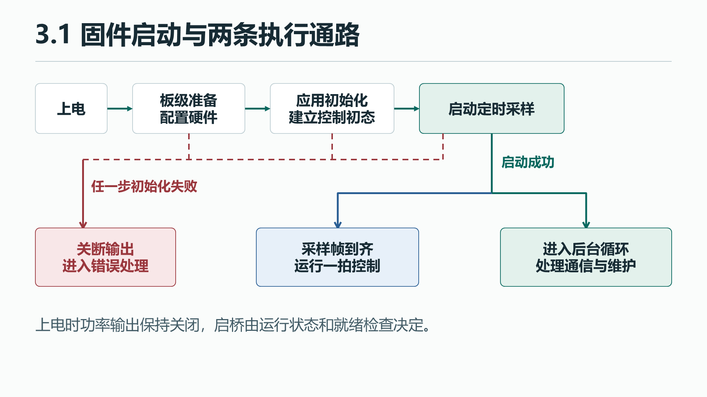

# 3.1 工程启动

[课程首页](index.md) · [软件操作手册](#软件操作手册) · [下一节 3.2 逆 Park、SVPWM 与 PWM 输出](01-pwm-svpwm.md)

上电后，固件要先准备输入和输出，再让控制程序接手。沿启动顺序读一遍，就能找到应用初始化、控制拍和后台循环各自从哪开始。

## 1.1 工程问题与通路

想象设备刚接通控制侧电源。它还没有可用的反馈，功率输出应保持关闭。先准备采样与输出所需的硬件，再给应用建立初始状态，最后才启动定时采样。只要某一步失败，后续步骤就暂停，输出进入关断状态。

{: .diagram}

周期控制由采样节拍决定。后台在控制拍之外继续处理通信和维护，应用状态把两条路径连接起来。

## 1.2 高层代码领读

### 找到控制应用的入口

`MotorApp_Init()` 在进入第一次采样前建立应用状态。下面节选控制对象初始化与初始状态赋值。 [应用初始化](source.md#app-motor-app-c-l72)

~~~c
Foc_Init(&foc);
Rotor_Init(&rotor);
// 此处省略读取标定数据及清理运行状态
state = APP_OFFSET;
~~~

`&foc` 和 `&rotor` 将两个状态对象的地址交给初始化函数。`APP_OFFSET` 表示下一步要用零电流读数建立基线。换 MCU 时，板级仍需在调用周期控制前让应用完成初始化。

### 区分周期控制与后台循环

`MotorApp_Background()` 处理通信和维护。周期控制有独立的 `MotorApp_CurrentIsr()` 入口，板级交付一帧采样结果后才调用一次。两条路径的执行频率由不同事件决定。 [后台函数](source.md#app-motor-app-c-l575) · [3.5 采样、中断与一拍控制](04-sampling-zero.md)

## 2.1 BSP 与 CubeMX 领读

### 从 CubeMX 生成代码走到应用调用

**源码摘录｜应用接手之前执行的 STM32 初始化**

~~~c
int main(void)
{
  MPU_Config();
  SCB_EnableICache();
  HAL_Init();
  SystemClock_Config();
  PeriphCommonClock_Config();
  MX_GPIO_Init();
  MX_DMA_Init();
  MX_TIM1_Init();
~~~

芯片的启动代码准备好 C 运行环境后进入这个函数。`int` 是返回类型，`void` 表示没有参数。摘录到 TIM1 为止，其余外设初始化完成后，接着执行三个手写调用。 [启动入口](source.md#core-src-main-c-l73)

前两句配置内存访问规则与指令缓存。`HAL_Init()` 准备 ST 的硬件访问库。时钟配置完成后，`MX_…_Init()` 依次配置引脚、DMA 数据搬运和定时器等外设。CubeMX 根据 `.ioc` 生成这些设置。3.2 从 `MX_TIM1_Init()` 跳进定时器的定义。 [CubeMX 示例参数摘录](reference.md#示例配置) · [TIM1 初始化](source.md#core-src-tim-c-l30)

**源码摘录｜外设配置结束后的手写启动调用**

~~~c
  if (!Board_Init() ||
      !MotorApp_Init() ||
      !Board_Start())
  {
    Error_Handler();
  }
~~~

`名字()` 表示调用函数。`if` 计算括号中的条件，条件为真才执行花括号内的语句。这里按顺序检查板级准备、初始化应用状态、启动采样和定时器通道。`!` 把返回的真假反过来，`||` 表示「或」。例如 `Board_Init()` 返回 `false` 时，第一个条件成立，后两个调用跳过，程序进入 `Error_Handler()` 关桥并停留在错误处理循环。三个返回值均为 `true` 时，`main()` 继续进入后台。 [板级准备](source.md#bsp-board-c-l144) · [应用初始化](source.md#app-motor-app-c-l72) · [启动采样与通道](source.md#bsp-board-c-l175) · [错误处理](source.md#core-src-main-c-l265)

**源码摘录｜启动成功后的后台循环**

~~~c
  /* USER CODE BEGIN WHILE */
  while (1)
  {
    /* USER CODE END WHILE */

    /* USER CODE BEGIN 3 */
    MotorApp_Background();
  }
  /* USER CODE END 3 */
~~~

`USER CODE BEGIN` 和 `END` 是 CubeMX 用来识别保留区域的注释。后台调用位于 `USER CODE 3` 区域，三个手写启动调用位于 `USER CODE 2`。开启 **Keep User Code when re-generating** 后，重新生成会保留这些区域中的代码。这些调用的定义维护在 `bsp/` 和 `app/`，控制算法另放在 `control/`。读完电流环后，后续的软件分层专题会把各目录的职责串起来。 [启动保留区域](source.md#core-src-main-c-l118) · [副本再生成步骤](#在副本重新生成) · [3.8 固件分层与移植](06a-software-architecture.md)

## 2.2 LAB 实机操作与验收

### 软件操作手册

下面按固定版本 `chapter-3` 打开、构建或重新生成。 [示例工程](https://github.com/pjzjwzx/foc-stm32-example) · [下载 chapter-3 ZIP](https://github.com/pjzjwzx/foc-stm32-example/archive/refs/tags/chapter-3.zip)

[准备工具](#1-准备工具和文件) · [打开配置](#2-在-cubemx-打开已有配置) · [导入工程](#3-在-cubeide-导入找到并跟随代码) · [首次构建](#首次构建) · [在副本重新生成](#在副本重新生成)

#### 1　准备工具和文件

MCU 是板上执行程序的芯片。这套工程的 MCU 是 **STM32H743VIT6**。电脑上的两个工具分别处理它的配置和程序。

| 需要什么 | 怎么获取与确认 | 什么时候用 |
|---|---|---|
| STM32CubeMX | 下载 Windows 版 STM32CubeMX，解压后运行安装程序。本章参考 6.16.1 | 看芯片、引脚、时钟和外设设置，选做生成 C 初始化代码 |
| STM32CubeIDE | 下载 Windows 版 STM32CubeIDE 并安装。本章参考 2.0.0，首次构建使用 IDE 自带的 ARM GCC | 找到和阅读 C 文件，构建固件 |
| STM32CubeH7 V1.12.1 | 在 CubeMX 打开固件包管理器，核对 H7 的版本和安装状态 | 按原配置重新生成代码时使用 |
| 教程配套工程 | 下载本节上方的固定版本 ZIP。右键选 **全部解压缩**，进入解压后的目录 | CubeMX 与 CubeIDE 都指向这份工程 |

[STM32CubeMX 下载](https://www.st.com/en/development-tools/stm32cubemx.html) · [STM32CubeIDE 下载](https://www.st.com/en/development-tools/stm32cubeide.html) · [STM32CubeH7 固件包说明](https://www.st.com/en/embedded-software/stm32cubeh7.html)

**核对 H7 固件包。** 在独立 CubeMX 中打开 **Help → Manage embedded software packages**，展开 STM32H7，找到 **V1.12.1**。已有安装时，管理器会显示该版本已安装。需要安装时，在该页选择对应版本安装，或使用从 ST 获取的该版本压缩包。若列表里同时出现几个版本，按完整版本号选。仓库已经带有这套工程构建所需的 HAL 和 CMSIS 文件，因此你可以先完成 IDE 的构建练习，再处理重新生成所需的固件包。 [ST 固件包安装图示](https://wiki.st.com/stm32mcu/wiki/Getting_started_with_STM32Cube_MCU_Package)

**认出工程根目录。** 在资源管理器打开解压后的文件夹，启用 **查看 → 显示 → 文件扩展名**。如果外层只有另一个同名文件夹，再进去一层。看到下面这些项目时，就到了后面要选的目录。

~~~text
foc-stm32-example-chapter-3/
├── FOC_Arclab_H743_V3.ioc
├── .project
├── .cproject
├── Core/
├── config/
└── tools/
~~~

| 文件或目录 | 现在只需知道 |
|---|---|
| FOC_Arclab_H743_V3.ioc | CubeMX 读取的配置，记下引脚、时钟、定时器等选择 |
| .project | CubeIDE 用它识别已有项目和项目名 |
| .cproject | CubeIDE 用它确定编译哪些目录、在哪里找头文件、怎样链接 |
| Core/ | 当前工程已经生成的启动、初始化和中断代码 |
| config/ | 课程实验阶段、板级参数、电机参数的头文件 |

~~~text
CubeMX ── 打开 .ioc ─────────────────┐
                                     ├─ 工程根目录
CubeIDE ── 将 .project 登记到 workspace ─┘
                  └── 构建后得到 Release 目录里的 ELF
~~~

可以把工程放在 **D:\FOC-Learn\project**，把工作区放在 **D:\FOC-Learn\workspace**。这两个都是示例，后面浏览文件时用你自己的路径。workspace 会记录你打开过哪些工程、面板如何排布等信息，源码仍放在工程目录。

#### 2　在 CubeMX 打开已有配置

##### 2.1 找到正确的工程

1. 启动独立的 **STM32CubeMX**。
2. 点击 **File → Load Project…**，浏览到工程根目录，选择 **FOC_Arclab_H743_V3.ioc**，点击 **Open**。首页的打开已有工程入口也会进入同一个文件选择步骤。
3. 如果出现旧版工程的迁移对话框，选择 **Continue**，沿用项目数据库。这个工程记录的是 **DB.6.0.150**。安装版本比项目记录的新时，出现提示是正常的。若所需数据库尚未安装，按官方工具提示补齐该版本。遇到外设出现红色冲突时，先检查是否误选了迁移或打开了另一份工程。
4. 打开后先确认器件是 **STM32H743VITx**，配套芯片的完整订货型号为 **STM32H743VIT6**。配置页应能看到 TIM1、ADC 和 FDCAN1 等已使用的外设。

CubeMX 的项目文件原来由 6.15.0 写入。此前的生成验证使用 6.16.1 加载它并保留旧数据库。两处版本号分别表示写入配置的工具版本与打开它的工具版本。 [ST 官方界面与 Load Project/Continue 说明](https://dev.st.com/stm32cube-docs/stm32cubemx/6.18.1/en/docs/markup/CubeMX_UserManual/chapters/04_4_stm32cubemx_user_interface.html) · [本工程版本验证](reference.md#验证记录)

##### 2.2 先认识四个位置

把配置界面当成板子的地图。按表从上到下看，每次只核对一个结果。

| 点哪里 | 这里的选项控制什么 | 本工程要看到什么 |
|---|---|---|
| **Pinout & Configuration**，右侧芯片图 | 每个引脚接到哪个硬件功能。一个引脚可在若干功能中选一个 | 在图上找到 PA8，核对其 TIM1_CH1 功能。详细接线可回查配置表 |
| **Clock Configuration** | 芯片内部把时钟分给不同硬件。频率的单位是 Hz，图中常用 MHz | 找到 CPU 480 MHz、APB2 120 MHz 和 TIM1 使用的定时器时钟 240 MHz。记下这三个数字的名称 |
| **Pinout & Configuration → Timers → TIM1** | TIM1 像一个会重复计数的硬件秒表。通道、计数方式和周期由这里选择 | 打开 **Configuration → Parameter Settings**，找到 **Counter Mode**，核对中心对齐模式 3 |
| **Project Manager** | 工具生成代码时使用的工程名、输出格式和固件包 | 工程名 FOC_Arclab_H743_V3，Toolchain / IDE 为 STM32CubeIDE，固件包为 H7 V1.12.1。切到 **Code Generator** 找到保留用户代码的选项 |

[ST 官方 Pinout、Clock 与 Project Manager 图示](https://www.st.com/resource/en/user_manual/um1718-stm32cubemx-for-stm32-configuration-and-initialization-c-code-generation-stmicroelectronics.pdf) · [本工程外设选项速查](reference.md#示例配置)

**从选项找到一行 C。** 在 CubeMX 中看到的 **Counter Mode** 表示计数器怎样走。打开 [TIM1 初始化代码](source.md#core-src-tim-c)，搜索以下一行。

~~~c
htim1.Init.CounterMode = TIM_COUNTERMODE_CENTERALIGNED3;
~~~

这一句可以分成三部分。

- 左侧的 htim1 是存放 TIM1 设置的对象。点号依次进入 Init，再找到其中的 CounterMode。
- 等号把右边的值写进左边。右侧的长名字表示中心对齐模式 3，和界面上核对的选项对应。
- 句末的分号表示这一条 C 语句结束。初始化函数会把这些设置应用到定时器。3.2 会继续追它怎样决定 PWM 周期。

这就是本课程使用 CubeMX 的方法。先找选项，再找生成的 C，随后观察这句对整个信号路径有什么影响。第一次打开时使用现有值即可继续。

#### 3　在 CubeIDE 导入、找到并跟随代码

##### 3.1 导入现成工程

1. 启动 **STM32CubeIDE**。在 **Workspace Launcher** 里点 **Browse…**，选一个空目录，例如 **D:\FOC-Learn\workspace**，再点 **Launch**。如果已经打开其他工作区，用 **File → Switch Workspace → Other…** 切换。
2. 点 **File → Import…**。在导入窗口展开 **General**，选择 **Existing Projects into Workspace**，点 **Next**。
3. 选择 **Select root directory**，点 **Browse…**，选择**刚才看到 .project 的文件夹**。列表里应出现勾选的 **FOC_Arclab_H743_V3**。
4. 保持 **Copy projects into workspace** 未勾选，点 **Finish**。这样 CubeIDE 修改的是你指定的工程文件夹，和 CubeMX 打开的文件属于同一份工程。
5. 在左侧 **Project Explorer** 展开该工程。右键工程名，打开 **Properties → Resource**，检查 **Location** 指向你选的目录。

如果列表里提示项目已存在，通常是工作区已登记了同名项目。查看已有项目的 Location，或切到一个空工作区再导入。若导入列表为空，回到资源管理器确认所选目录下确实有 .project，而非只含 .ioc 的下载目录或外层压缩包。

ST 的 2.0 工作流第 2.4 节还展示了 **File → STM32 Project Create/Import → STM32CubeMX/STM32CubeIDE Project** 入口。官方截图可以帮助识别导入向导及导入完成后的工程树。本章采用上面的 Existing Projects 路线。 [ST 官方 CubeIDE 2.0 导入截图](https://community.st.com/stm32-mcus-60/stm32cubeide-2-0-0-workflow-tutorial-160701) · [STM32CubeIDE 用户手册](https://www.st.com/resource/en/user_manual/um2609-stm32cubeide-user-manual-stmicroelectronics.pdf)

##### 3.2 练一次查找和跳转

| 区域 | 用来做什么 | 现在试一下 |
|---|---|---|
| **Project Explorer** | 看工程中的文件夹和文件 | 展开 **Core → Src → main.c**，双击打开 |
| **编辑器** | 阅读与修改文件 | 按 **Ctrl+F** 搜索 MotorApp_Init，关掉查找框，将光标点在源码中的函数名上。按 **F3** 跳到定义，再用 **Alt+左箭头** 回到调用处 |
| **Console** | 看这次构建做过哪些事 | 稍后在底部找编译命令和最终状态 |
| **Problems** | 汇总错误和警告，点一条可跳到代码 | 若没显示，从 **Window → Show View** 找到 Problems。Console 同理 |

用本页前面的启动判断练一次跳转。在 `main()` 里找到 `MotorApp_Init()`，跳到它的定义，再返回到原来的条件表达式。 [回看调用处](source.md#core-src-main-c-l123)

#### 首次构建

##### 4.1 找到课程阶段

在 Project Explorer 展开 **config → lab_config.h**。若文件夹显示折叠，按 **Ctrl+Shift+R**，输入 **lab_config.h**，选择本工程里的文件。打开后定位这一段。

~~~c
#define LAB_PWM_SVPWM 1
#define LAB_OPEN_LOOP 2
#define LAB_SENSORS 3
#define LAB_TRANSFORMS 4
#define LAB_CURRENT_PI 5
#define LAB_SPEED 6
#define LAB_CAN_MIT 7

#ifndef LAB_STAGE
#define LAB_STAGE LAB_CAN_MIT
#endif
~~~

读完这四点再改。

- 第 1 至 7 行为七个数字取名字。比如 LAB_PWM_SVPWM 就代表 1。以 **#** 开头的指令由构建工具在编译 C 之前处理。
- **#ifndef LAB_STAGE** 可以读作“如果构建时还没有给 LAB_STAGE 赋值”。
- **#define LAB_STAGE LAB_CAN_MIT** 在上面的条件成立时，指定默认使用第 7 阶段。
- **#endif** 结束这个条件区域。

把**指定 LAB_STAGE 的一行**改成下面这样，保留其余阶段编号。按 **Ctrl+S** 保存。

~~~c
#define LAB_STAGE LAB_PWM_SVPWM
~~~

阶段决定这一份固件开放哪些实验功能。保存会更新电脑上的源文件，构建会生成包含这次变化的 ELF。上板时还需下载本次 ELF，再让芯片运行。 [对应配置文件](source.md#config-lab-config-h)

##### 4.2 得到 Release ELF

1. 在工程树中选中工程，右键 **Build Configurations → Set Active → Release**。Release 是一组现成的构建选项。它决定输出目录和优化设置。
2. 右键工程，点 **Build Project**。如果菜单中选了 Debug，产物会出现在 Debug 目录。先检查活动配置，再找文件。
3. 看 Console 最后几行。构建先把各个 C 文件翻译成目标文件，再由链接器把它们合成一个程序。成功时应有 **Finished building target** 和 **0 errors**，并生成 ELF。
4. 在 Project Explorer 刷新工程，展开 **Release**，找到 **FOC_Arclab_H743_V3.elf**。也可以用资源管理器到**工程根目录 → Release** 核对文件及更新时间。

以下是这份工程在独立工作区、切到 LAB1 后的 CubeIDE 构建日志节选。IDE 界面的 Console 会显示同类结果。

~~~text
Finished building target: FOC_Arclab_H743_V3.elf
Build Finished. 0 errors, 0 warnings.
~~~

ELF 是电脑上的构建产物，里面包含程序和调试所需的符号。找到本次生成的 ELF 就完成了首次构建。3.2 用生成代码读 PWM，3.3 再按本手册的构建方法准备并下载 LAB2。

##### 4.3 构建报错时，从第一条开始

先看 Console 中第一条具体报错。Problems 里常会同时列出后续错误，第一条通常更接近真正原因。下列为报错样式示例。

| 第一条提示可能长什么样 | 它告诉你什么 | 先做什么 |
|---|---|---|
| fatal error: lab_config.h: No such file or directory | 编译器看到了头文件名，但搜索路径里找不到它 | 确认文件存在于 config，并确认导入了带完整 .cproject 的根目录 |
| No rule to make target 或找不到某个 .c | 构建仍指向一个不存在的源码位置 | 核对工程目录是否完整、Location 是否正确，再 Clean/Build |
| undefined reference to MotorApp_Init | 编译器见到了函数声明，链接器找不到实现 | 确认 app 下的实现文件参与了构建。若刚用 CubeMX 重新生成，按下面的方法恢复工程配置 |
| 成功却找不到 Release/…elf | 可能在看另一份工程，或使用了 Debug | 核对 Console 的目标名、活动配置和工程的 Location |

#### 在副本重新生成

通过首次构建后，再做这项实验。这里沿用现有 .ioc 的参数，练习从配置生成 C 和恢复构建。

1. 在资源管理器复制整个工程到新目录。用独立 CubeMX 打开**副本**的 .ioc，核对工程位置、Toolchain / IDE 和 **Keep User Code when re-generating**。
2. 点击 **GENERATE CODE**。生成器会写入 Core 中的外设初始化代码，也可能重建 IDE 的工程配置。C 文件里成对出现的 **USER CODE BEGIN / END** 标出生成器应该保留的手写区域。
3. 比较副本的生成结果。先确认 main 中的应用调用还在、Flash 链接脚本的标定预留还在，再检查 .cproject 是否仍包含 app、bsp、control、communication 等编译目录。
4. 在副本根目录打开终端。Windows 11 可在文件夹空白处右键选 **在终端中打开**。输入 **python --version** 确认可用，再执行下面一行。它恢复本工程的源文件目录和头文件搜索路径。若工具报告标定 Flash 预留缺失，先用原工程的链接脚本恢复预留。
5. 在另一个空 workspace 中导入这个副本，或在已导入的副本上右键 **Refresh**。核对 LAB_STAGE，重新构建并找到对应 ELF。

~~~powershell
python tools/build.py --restore-project
~~~

[本工程的重新生成与恢复说明](reference.md#示例配置) · [实际验证结果](reference.md#验证记录)

#### 工具操作核对

CubeMX 的 TIM1 Counter Mode 应为中心对齐模式 3，`tim.c` 中可找到对应赋值。CubeIDE 的 Location 应指向解压后的工程根目录，并能从 `main()` 跳到 `MotorApp_Init()` 的定义。首次构建采用 `LAB_STAGE=LAB_PWM_SVPWM`，输出在 **Release/FOC_Arclab_H743_V3.elf**。

### 这份代码从哪里来

本文以同一份 20 kHz 教学工程为例，使用 STM32H743 电机驱动板与角度编码器。源码定位索引记录了与本课对应的文件及行号。 [源码定位](source.md)

[课程首页](index.md) · [下一节 3.2 PWM 与 SVPWM](01-pwm-svpwm.md)
