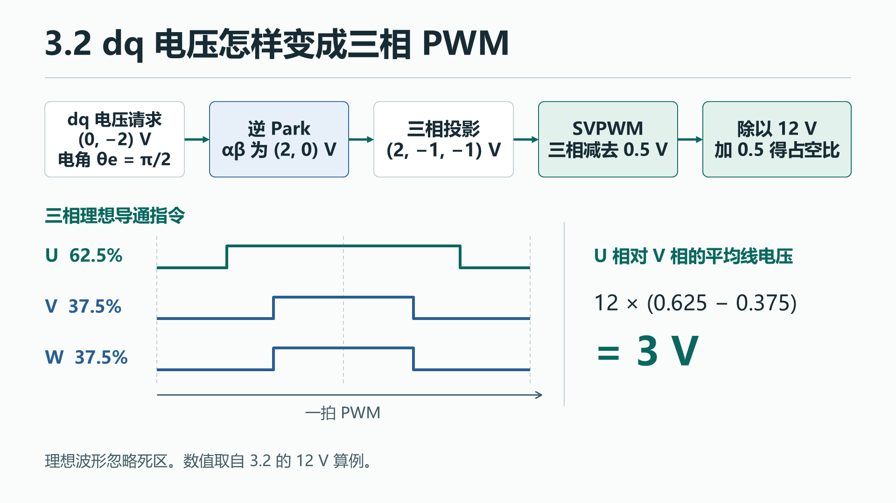

# 3.2 逆 Park、SVPWM 与 PWM 输出

[上一节 3.1 工程启动](00-project.md) · [下一节 3.3 第一次电压开环](02-open-loop.md)

控制器每拍给出一组 dq 电压。顺着逆 Park、SVPWM 和 TIM1 的比较逻辑，可以解释这组电压最后怎样变成三路 PWM。

## 1.1 工程问题与通路

dq 电压是在跟随转子的坐标系里给出的。逆 Park 用当前电角把它转到定子坐标系。接下来，调制器给三个桥臂分配导通比例，由开关在一拍里产生所需的平均线电压。

[](../docs/assets/chapter-3/01-pwm-svpwm.png){: .diagram}

例如母线电压为 12 V 时，两相占空比分别为 62.5% 和 37.5%，理想平均线电压就是 `12 × (0.625 − 0.375) = 3 V`。同一组比例交给不同 MCU 时，算法输出的含义相同，平台负责让脉冲按约定生效。

## 1.2 高层代码领读

<span id="通用-foc-部署"></span>
<span id="通用部署"></span>

### 从扇区法读懂 min/max SVPWM

逆 Park 将 dq 电压转成静止坐标系的 `v_alpha`、`v_beta`。这两个量和母线电压 `Vbus` 是调制所需的输入。扇区法先找到附近的两个有效矢量，算出它们和零矢量各占一拍多少时间，再从开关序列得到三相 duty。这个工程把工作转到三相参考上。以下是同一个函数连续执行的两段代码。

#### 先得到三相电压参考

进入 `Foc_VoltageStep()` 时，输入是 d/q 电压、给定电角和母线电压。控制对象地址为空时直接返回 `false`。有控制对象时，函数检查数值和母线条件，再把 d/q 矢量等比例限制在电机配置与母线共同允许的范围内。输入检查或限幅失败时，它把软件输出恢复到中性值并返回 `false`，运行分支据此处理停机。有效输入继续做逆 Park。 [电压检查与限幅](source.md#control-foc-c-l90)

```c
Foc_InversePark(vd, vq, angle, &foc->alpha_voltage_V, &foc->beta_voltage_V);
float phase[3] = {
    foc->alpha_voltage_V,
    -0.5f * foc->alpha_voltage_V + 0.86602540378f * foc->beta_voltage_V,
    -0.5f * foc->alpha_voltage_V - 0.86602540378f * foc->beta_voltage_V
};
```

`foc` 指向控制对象，`&foc->alpha_voltage_V` 把字段的地址交给逆 Park，函数可以把结果写回来。写回的 αβ 电压随后进入三相投影。接下来的三个表达式把同一支 αβ 电压箭头投影到相隔 120° 的三个轴上，依次得到 U、V、W 三相参考，单位是 V。逆 Park 使用给定电角的正余弦。 [逆 Park 定义](source.md#control-foc-c-l41) · [调用与三相投影](source.md#control-foc-c-l119)

#### 给三相加同一个偏移

```c
float minimum = fminf(phase[0], fminf(phase[1], phase[2]));
float maximum = fmaxf(phase[0], fmaxf(phase[1], phase[2]));
/* 给三相同时加入相同零序电压，不改变线电压，即min/max形式SVPWM。 */
float center = 0.5f * (minimum + maximum);
for (unsigned i = 0; i < 3U; ++i)
    foc->duty[i] = Clamp(0.5f + (phase[i] - center) / bus_voltage_V, 0.0f, 1.0f);
return true;
```

1. `minimum` 和 `maximum` 找出当前这一拍的最低、最高相参考，`center` 取两者的中点。
2. 三相都减去 `center` 后，最高和最低值关于 0 对称。相减时公共偏移抵消，例如 `(vU−center)−(vV−center)=vU−vV`。所以这一步能安排三相脉冲的公共部分，同时保留电机端的线电压指令。
3. 每相再除以 `bus_voltage_V`，把电压变成比例。加上 0.5 后写入 `duty[i]`，`Clamp` 把它限制到 0～1。三相算完，`return true` 回到调用处。 [调制源码](source.md#control-foc-c-l125)

#### 为什么这和你熟悉的扇区法能对上

用 **H、M、L** 表示本拍 duty 从大到小的三个相，字母随矢量角度改变。对同一条中心对齐载波，较大的 duty 覆盖较小的 duty。在线性调制范围内、忽略死区与计数取整，按 H/M/L 的顺序看上桥状态，会出现以下四种组合。

| 上桥状态 | 整拍占比 | 在扇区法里对应什么 |
|---|---|---|
| `000` | `1 − dH` | 三相上桥都关闭时的零矢量 |
| `100` | `dH − dM` | 只有 H 相上桥导通的有效矢量 |
| `110` | `dM − dL` | H、M 两相上桥导通的有效矢量 |
| `111` | `dL` | 三相上桥都导通时的零矢量 |

`100` 和 `110` 的身份由 H、M、L 当前分别是哪一相决定。这就是扇区法要找的两个相邻有效矢量。它们的作用时间等于上表的比例乘以 PWM 周期。min/max 居中还令 `dH+dL=1`，于是两种零矢量等分剩余时间。采用同一归一化和等分零矢量的对称扇区法时，理想 duty 可以逐相对上。工程只需求三相投影的最大、最小值，比较器会根据三个门槛自然形成相应的开关顺序，省去 `atan2`、显式判扇区和查表。

<span id="在模型里核对占空比"></span>

### 从 dq 输入算出三相占空比

取 `Vd=0 V`、`Vq=−2 V`、电角 `θe=π/2` 和 `Vbus=12 V`。这个矢量在示例限幅内。逆 Park 得到 `(vα, vβ)=(2, 0) V`，投影后三相参考为 `(2, −1, −1) V`。减去共同的 `0.5 V`，再除以母线电压并加 0.5，得到 `duty=(0.625, 0.375, 0.375)`。U 与 V 相的 duty 差乘以 12 V 等于 3 V，与投影后的线电压差一致。2.1 沿用同一组数值计算比较值。

如果用模型对照扇区法，两个实现须采用同一相序、电压尺度和限幅。相间 duty 差一致而逐相 duty 有共同偏移时，对应的线电压相同，零矢量分配有差异。

## 2.1 BSP 与 CubeMX 领读

<span id="stm32-部署示例"></span>
<span id="stm32-实现"></span>

### 从计数器看到引脚波形

`CNT` 是用来和各相比较值相比较的三角载波。定时器从 0 数到 ARR 再数回 0，才走完一个载波周期。本例送进 TIM1 的时钟为 240 MHz，`PSC=0`，`ARR=6000`。计数时钟为 `240 MHz/(PSC+1)`，一个周期走 `2×ARR` 个计数节拍。

```text
f_pwm = f_tim / [(PSC + 1) × 2 × ARR]
      = 240 MHz / (1 × 2 × 6000) = 20 kHz
T_pwm = 50 μs
```

每相的 CCR 相当于一条比较线。对本例的 PWM2，计数靠近峰顶、越过比较线后，主通道参考信号有效。上升段越早跨过 CCR、下降段越晚回到 CCR，主通道的有效区间就越宽。下面只画定时器内部的比较逻辑。 [ST RM0433 的 PWM Mode 与中心对齐波形](https://www.st.com/resource/en/reference_manual/rm0433-stm32h742-stm32h743-753-and-stm32h750-value-line-advanced-armbased-32bit-mcus-stmicroelectronics.pdf)

```text
计数时刻    谷底       上数经过 CCR        峰顶        下数经过 CCR      谷底
CNT          0  ───────↗  CCR  ───────↗   ARR  ───────↘  CCR  ───────↘  0
OCxREF      无效  ────────┘ 有效 ────────────────────────└───── 无效
                    <--------------- 一个载波周期 --------------->
```

对一个桥臂，定时器在互补通道的换向之间插入死区。下面画的是导通指令的顺序，实际引脚电平还由极性、输出使能和空闲设置决定。MOE 是定时器的总输出允许，EN_GATE 是功率驱动的使能，两者要分别看。 [定时器互补输出与死区](https://www.st.com/resource/en/application_note/an4013-stm32-crossseries-timer-overview-stmicroelectronics.pdf)

```text
上数经过 CCR                              下数经过 CCR
下桥导通 → 两路关断（死区）→ 上桥导通 → 两路关断（死区）→ 下桥导通
```

改 duty 时还有一条时间线。以本例在上数阶段提交为例，软件写入的是预装载值，峰顶更新事件才把它交给比较器。采样到写入的时间预算要看这个生效边界，后续的采样与中断专题会沿这条时序继续追。 [3.5 采样、中断与一拍控制](04-sampling-zero.md)

```text
计数方向         上数，接近峰顶                         到峰顶并转为下数
软件与硬件       软件写 CCR 预装载值 ─────────────────→ 更新事件锁存
比较器使用       旧 CCR                                新 CCR
```

现在看板级代码里真正把 duty 送给定时器的这一行。

```c
uint32_t compare = (uint32_t)((1.0f - duty[i]) * (float)TIM1->ARR);
```

`duty[i]` 是第 `i` 相的占空比。这里的 `TIM1->ARR` 表示访问 TIM1 寄存器中的计数上限。忽略死区与整数截断时，PWM2 在每半程的有效区间为 `ARR−CCR`，所以比例是 `1−CCR/ARR`。反过来求 CCR，就得到源码里的 `(1-duty)×ARR`。结果转成整数后依次写进三路 CCR。换 PWM 模式或输出极性时，要按新的比较逻辑重新确认这一映射。 [比较值写入](source.md#bsp-board-c-l104)

同一组 `duty=(0.625, 0.375, 0.375)` 在本例 `ARR=6000` 时得到 `(CCR1, CCR2, CCR3)=(2250, 3750, 3750)`。U 相门槛较低，在同一载波上比 V、W 相更早进入有效区间。

<span id="在-cubemx-配好-pwm"></span>

### CubeMX 参数怎样进入初始化代码

这里对照已保存的 `.ioc` 参数和 **STM32H743 的 TIM1** 生成代码。换一款 STM32 时，先从目标芯片和板卡的引脚表找能输出所需 PWM 的定时器，核对它有多少组互补通道、是否支持死区、怎样触发 ADC。引脚位置、时钟倍频规则和触发路由都从目标工程重新确认。 [打开工程的方法](00-project.md#软件操作手册) · [CubeMX 示例参数摘录](reference.md#示例配置) · [ST 跨系列定时器概览 AN4013](https://www.st.com/resource/en/application_note/an4013-stm32-crossseries-timer-overview-stmicroelectronics.pdf)

<span id="先选时钟通道和引脚"></span>

#### 时钟、通道和引脚

| 配置位置 | H743 示例与代码落点 |
|---|---|
| **Clock Configuration** | APB2 为 120 MHz，TIM1 计数时钟为 240 MHz。对应 `SystemClock_Config()`。 |
| **Pinout & Configuration → Timers → TIM1 → Mode** | 使用内部时钟。CH1、CH2、CH3 各有互补输出，CHx/CHxN 对应同一桥臂。 |
| **Pinout** | CH1/2/3 对应 PA8/PA9/PA10，CH1N/2N/3N 对应 PB13/PB14/PB15。引脚复用由 `HAL_TIM_MspPostInit()` 设置。 |

[时钟初始化](source.md#core-src-main-c-l148) · [PWM 引脚初始化](source.md#core-src-tim-c-l135)

<span id="再填-tim1-的参数"></span>

#### TIM1 参数

下表把 TIM1 的 **Parameter Settings** 对应到示例参数和生成代码。

| 查哪里 | 本工程选择 | 为什么要查 |
|---|---|---|
| Counter Settings → Prescaler / Counter Mode / Counter Period | PSC = 0，Center Aligned Mode 3，Period = `PWM_COUNT-1` | 预分频因子是 `PSC+1`。中心对齐让计数器来回走。头文件里的 `PWM_COUNT=6001`，因此实际计数上限 ARR = 6000。对应 `htim1.Init.Prescaler`、`CounterMode`、`Period`。 |
| Counter Settings → Clock Division / Repetition Counter | DIV1 / 0 | Clock Division 决定死区等逻辑用的内部时钟分频。计数速率用前面的 PSC 推导。重复计数为 0，更新事件按本例的上、下端点规则出现。 |
| Auto Reload Preload / PWM 通道预装载 | ARR 预装载 Enable。CH1–3 的比较值预装载由 HAL 的 PWM 通道配置打开 | 预装载是先写待生效值，再随更新事件交给比较逻辑，便于把三相更新放到同一个边界。检查 `AutoReloadPreload` 和 HAL 设置的 `OCxPE` 位。 |
| PWM Generation Channel 1/2/3 → Mode、Pulse、Polarity、Idle State | PWM Mode 2。主、互补极性均为 High，主 Idle State 为 Reset、互补为 Set | 模式决定 CNT 和 CCR 如何比较，极性和空闲电平决定输出给驱动器的电平。生成代码的初始 Pulse 为 65535，手写的 `Board_Start()` 在启动通道前把三路比较值设为 `ARR/2`。 |
| Break and Dead Time | `DeadTime = 10`，OSSR/OSSI Enable，Break/Break2 和 Automatic Output Disable | `10` 是本例的死区编码。换板要按内部时钟、器件参考手册和驱动器要求重新核算。示例板的驱动故障经 GPIO 中断进入关断路径，目标板应按实际保护连接核对停机后的输出状态。 |
| Channel 4 / Trigger Output | CH4 选 **PWM Generation4 No Output**，模式 PWM1，Pulse = 1。TRGO 选 OC4REF，TRGO2 为 Reset | CH4 使用自己的比较值，并且无需占用输出引脚。上数经过该比较值时，OC4REF 产生一次下降沿。本例的 ADC 选用这条边沿，详细采样时序见 3.5。 |

Counter Mode 里的 Up/Down 是单方向计数，Center Aligned 则在两个方向间往返。示例定时器的三种中心对齐模式共用往返计数方式，差别之一在于输出比较标志在哪个方向置位。Mode 3 会在两个方向置位。本例的 ADC 取 CH4 比较参考信号的下降沿。选择该边沿后，每个完整载波得到一次触发。 [H743 参考手册 RM0433](https://www.st.com/resource/en/reference_manual/rm0433-stm32h742-stm32h743-753-and-stm32h750-value-line-advanced-armbased-32bit-mcus-stmicroelectronics.pdf) · [ADC 触发配置](source.md#core-src-adc-c)

`MX_TIM1_Init()` 写入上面的定时器配置。本工程随后在 `Board_Start()` 启动采样和 PWM 通道，并把功率输出留在停机状态。 [定时器初始化](source.md#core-src-tim-c-l44) · [定时器预装载参考](https://www.st.com/resource/en/application_note/an4776-generalpurpose-timer-cookbook-for-stm32-microcontrollers-stmicroelectronics.pdf) · [板级启动](source.md#bsp-board-c-l175)


### 从算法输出接到引脚

LAB1 的固定测试参数会调用 `Foc_VoltageStep()`，随后把 `foc.duty` 交给 `Board_PwmProbeIsr()`。这个路径维持功率驱动关闭。3.3 继续用同一个调制函数，换成可调给定、实际母线和受保护的功率桥输出。 [LAB1 分支](source.md#app-motor-app-c-l498) · [引脚输出接口](source.md#bsp-board-c-l137)

## 2.2 LAB 实机操作与验收

### LAB1 关桥观察

按 3.1 的步骤构建 LAB1。若示例板能在功率断开的条件下独立运行控制侧，可按 3.3 的 SWD 方法下载本次 LAB1 ELF，保持功率断开。程序完成零偏采集并进入 Disabled 后，用板卡允许的低压参考测 MCU 的 PA8、PA9、PA10。 [首次构建](00-project.md#首次构建) · [SWD 下载](02-open-loop.md#保持功率断开用-swd-下载并运行)

- 同一引脚相邻上升沿应相隔约 50 μs。比较同一段记录中三相有效脉宽的变化顺序与 `foc.duty[0..2]`，给计数取整和死区留出差异。
- 查看驱动使能保持在关闭电平。本例 `Board_PwmProbeIsr()` 让 TIM1 输出波形，同时拉低 PD4。将引脚波形和驱动状态分开记录。 [引脚输出接口](source.md#bsp-board-c-l137) · [驱动与引脚配置](reference.md#示例配置)

开始 3.3 前，准备好目标板的三组 PWM 与相线对应关系、驱动器的有效电平与关断条件、控制侧供电和调试器接法。若用另一款 STM32，先在它的 CubeMX 工程和板级实现中逐项对照本章的时钟、通道、极性、死区与触发设置。 [板级配置检查表](reference.md#示例配置) · [下一节 3.3 开环部署](02-open-loop.md)

若驱动使能状态异常或功率未能保持断开，立即停止实验。实板波形待记录。 [验证记录](reference.md#验证记录)
