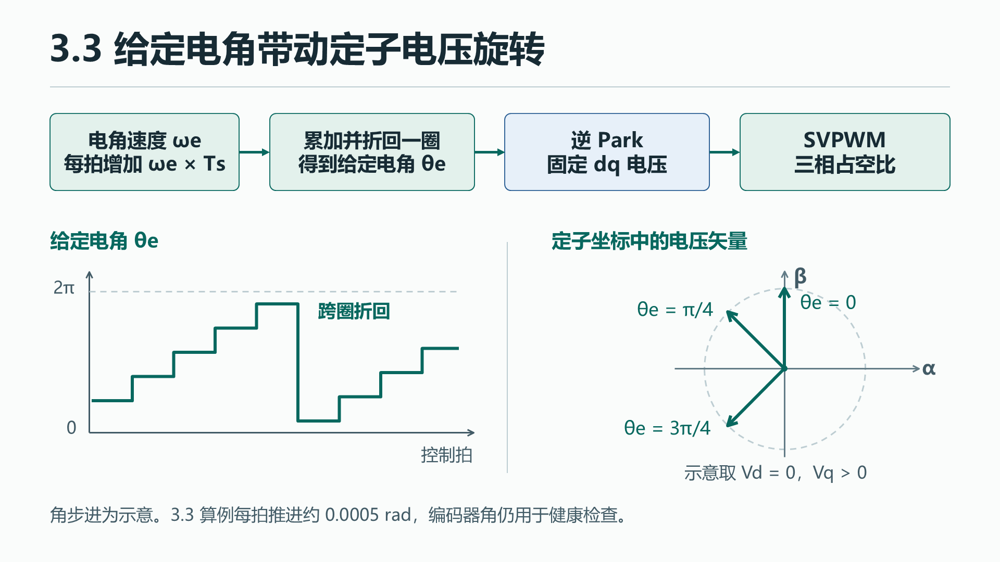
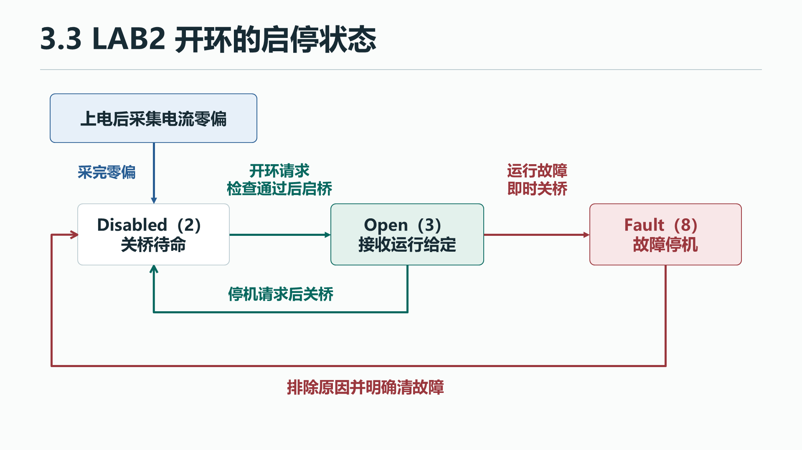

# 3.3 第一次电压开环

[上一节 3.2 逆 Park、SVPWM 与 PWM 输出](01-pwm-svpwm.md) · [下一节 3.4 电流与角度传感器](03-sensors.md)

第一次驱动电机，先把旋转电压、启桥检查和停机连成一条可追踪的通路。示例使用 LAB2，实机试转待验证。

## 1.1 工程问题与通路

开环时，应用自己推进给定电角。每拍按 `ωe × Ts` 增加角度，固定的 dq 电压请求随角度旋转，逆 Park 和 SVPWM 将它交给桥臂。编码器仍参与健康检查，驱动电压使用的是给定角。

[](../docs/assets/chapter-3/02-open-loop-01.png){: .diagram}

LAB2 上电先采集零偏。开环请求通过检查并启桥后，应用进入 Open 并持续接收电角速度和 Vq 给定。

[](../docs/assets/chapter-3/02-open-loop-02.png){: .diagram}

运行请求、驱动就绪和目标更新各有自己的时机。正常停机返回 Disabled，运行故障走关断路径并进入 Fault。

## 1.2 高层代码领读

<span id="通用-foc-部署"></span>
<span id="通用部署"></span>

### 将模型里的给定电角接到 SVPWM

固件的 `APP_OPEN` 分支将电角速度积分成给定电角，再把给定角与电压请求交给调制。 [开环分支](source.md#app-motor-app-c-l519)

**源码摘录**。这一段位于 `MotorApp_CurrentIsr` 的运行分支内，母线检查已通过，前面的模式选择和后面的 PWM 提交略去。

```c
else if (state == APP_OPEN)
{
    open_angle =
        Foc_WrapTwoPi(open_angle + reference.electrical_speed_rad_s * FOC_CURRENT_DT_S);
    ok = Foc_VoltageStep(&foc, open_angle, 0, reference.vq_V, bus);
}
```

第一条赋值把电角速度乘以控制周期，再加到旧的 `open_angle`。本工程每 50 μs 计算一次。用本章命令里的 10 rad/s 估算，每拍加约 0.0005 rad。实际 CAN 给定经量化会略有出入。`Foc_WrapTwoPi` 把新角折回 `[0, 2π)`，所以波形越过一圈时会回到接近 0 的值。电角速度为负时，给定角沿反方向走。这里的速度描述电压场转得多快，转子实际能否跟随还要观察。 [折回函数](source.md#control-foc-c-l20) · [控制周期定义](source.md#config-lab-config-h)

第二句把新角交给 3.2 读过的 `Foc_VoltageStep`。本例 `Vd=0`，`Vq` 取最新目标。函数仍按原来的顺序限幅，用逆 Park 得到 `vα/vβ`，再用 SVPWM 算三相 duty。结果写入 `foc`，成功或失败通过返回值交给本拍的 `ok`。回到应用后，继续走 PWM 提交判断。 [电压到 duty](source.md#control-foc-c-l108) · [返回后的提交](source.md#app-motor-app-c-l548)

| 信号 | 固件变量 | 单位与用途 |
|---|---|---|
| 给定电角速度 | `reference.electrical_speed_rad_s` | 电 rad/s，决定每拍角度增量 |
| 给定电角 | `open_angle` | rad，折回一电圈后用于逆 Park |
| dq 给定电压 | `0` 和 `reference.vq_V` | V，送进限幅和调制 |
| 母线电压 | `bus`，由板级接口交付 | V，用于电压限幅和 duty 归一化 |
| 输出占空比 | `foc.duty[0..2]` | 三相 0～1 的比例，交给板级提交接口 |

### 从停机到允许开环

`LAB_STAGE` 是构建时的能力选择。设为 LAB2 后，固件上电先采集电流零偏，随后停在 `APP_DISABLED`（2）。示例通过 CAN 请求 `APP_OPEN`（3），应用接受后才持续接收电角速度和 Vq。换平台时，本地按键或其他总线也可以提供运行请求和给定。应用先处理运行状态请求，再接收与当前状态匹配的目标。 [3.10 CAN MIT](08-can-mit.md)

`request_state` 先检查阶段是否允许目标状态、电流零偏是否采完，并要求首次开环从 Disabled 出发且无故障。开环目标可在功率输出就绪后更新。应用收到停机请求或检测到故障时，要让输出立即进入安全状态，并清掉本次运行的目标。换板时需要给应用提供等价的就绪检查和关断接口。 [状态入口](source.md#app-motor-app-c-l116) · [零偏完成时进入 Disabled](source.md#app-motor-app-c-l467)

**源码摘录**。继续在 `request_state()` 读首次进入 Open 等运行态时的检查。这里省略了停机、重复请求和成功发布状态的分支。

```c
if (encoder_good < 25 || !rotor.valid ||
    (uint32_t)(BSP_GetTimeUs() - rotor.sample_time_us) > FOC_ENCODER_STALE_US)
    return false;
if (target != APP_OPEN && !rotor.zero_valid)
    return false;
if (Board_BusVoltage() < 2.0f || !isfinite(Board_BusVoltage()))
    return false;
if (!Board_EnableDriver())
{
    MotorApp_FaultIsr(APP_FAULT_DRIVER);
    return false;
}
```

1. 编码器须累计 25 个有效样本、当前角有效，且最近样本年龄不超过 10 ms。Open 的旋转电压使用给定角，编码器仍负责健康检查和运行保护。
2. `target != APP_OPEN` 在本次请求中为假，所以首次开环可先使用给定电角，到 3.6 再建立反馈的电角基准。 [3.6 电零点与波形验算](05-transforms.md)
3. 母线值无效或小于 2 V 时拒绝启动。2 V 是这份程序的拒绝门槛。实际供电要按实板和电机的额定条件。
4. `Board_EnableDriver` 负责准备功率驱动并确认就绪，失败会记录驱动故障。通过后应用在短临界区复查状态和故障，清旧目标、记录命令时间，并将状态改为 Open。 [板级接口](source.md#bsp-board-h) · [状态发布](source.md#app-motor-app-c-l150)

电脑再发目标时，`MotorApp_AcceptCommand` 只接受新鲜、状态匹配且无故障的命令。应用一次性写入 `reference`，按配置限制电角速度与 Vq，并更新时间。控制程序每拍读取完整的最新目标。本例电脑脚本以 50 Hz 更新给定，板上每 50 μs 算一次。 [目标接收与限制](source.md#app-motor-app-c-l306)

LAB1 和 LAB2 用的是同一套逆 Park 与 SVPWM。LAB1 每秒推进一圈电角，用固定 `Vd=0 V`、`Vq=1 V` 和名义母线 24 V 算 duty，结果交给观察接口。LAB2 的 `APP_OPEN` 使用可调电角速度、Vq 和实际采样的母线，结果交给运行接口。[LAB1 与 Open 分支](source.md#app-motor-app-c-l498)

## 2.1 BSP 与 CubeMX 领读

<span id="stm32-部署示例"></span>
<span id="stm32-实现"></span>

### 追踪示例板的启桥检查

板级把驱动就绪、故障输入和关断提供为三个接口。PD4 和 PD5 的配置来自 GPIO 初始化，TIM1 输出行为见 3.2。 [示例配置](reference.md#示例配置)

| 接口 | 在 H743 示例板上做什么 |
|---|---|
| `Board_EnableDriver()` | 准备功率驱动器并检查配置和故障输入。失败时走关桥路径。 |
| `Board_DriverFault()` | 读取 PD5 的低有效驱动故障信号。 |
| `Board_StopIsr()` | 先清除 TIM1 的总输出允许位 MOE，再拉低 PD4 的驱动使能。 |

在 LAB1 中，`Board_PwmProbeIsr()` 保持 PD4 为低，只允许 TIM1 输出供观察。LAB2 的 `Board_ApplyDutyIsr()` 在应用允许且检查通过后，才把当拍的 duty 交给已准备好的功率输出。两个阶段的载波都是 20 kHz。 [板级接口](source.md#bsp-board-h) · [观察与运行提交](source.md#bsp-board-c-l118) · [关断入口](source.md#bsp-board-c-l69)

**源码摘录**。回到电流中断，运行分支最后检查这拍能不能提交。

```c
if (running() && (!ok || !Board_ApplyDutyIsr(foc.duty)))
    MotorApp_FaultIsr(APP_FAULT_SAMPLE);
```

状态仍在运行且 `ok` 为真时，`Board_ApplyDutyIsr` 检查占空比、驱动是否启用、故障输入和定时器提交窗口。`Board_DriverFault` 读板级故障输入。板级返回成功，应用接着记录诊断。计算失败时，`!ok` 已经为真，右边的提交函数不会调用。提交失败也走同一个故障处理，经 `Board_StopIsr` 关闭 PWM 总输出和驱动使能。母线异常、运行中编码器失效、过流以及运动命令超时也会关桥。该工程的通信超时阈值为 100 ms。 [提交检查](source.md#bsp-board-c-l118) · [关断入口](source.md#bsp-board-c-l69) · [本拍的保护判断](source.md#app-motor-app-c-l479)

## 2.2 LAB 实机操作与验收

### 构建 LAB2 并找到本次 ELF

以下构建、下载和 CAN 步骤使用固定标签 `chapter-3`。 [示例工程](https://github.com/pjzjwzx/foc-stm32-example) · [下载 chapter-3 ZIP](https://github.com/pjzjwzx/foc-stm32-example/archive/refs/tags/chapter-3.zip)

本节以 STM32H743 示例板、CubeIDE 2.0.0 和 ST-LINK 为例。用其他板时，先按板卡资料核对下载接口、供电和驱动允许条件。工程尚未导入时，先按 [3.1 软件操作手册](00-project.md#软件操作手册) 打开已解压的工程。只切换实验阶段时直接构建现有工程。

1. 在 CubeIDE 的 **Project Explorer** 展开 `config/lab_config.h`。找到 `#ifndef LAB_STAGE` 下面指定 `LAB_STAGE` 的一行，将它改成 `#define LAB_STAGE LAB_OPEN_LOOP`，按 **Ctrl+S** 保存。保留各阶段的编号定义。
2. 右键工程，选 **Build Configurations → Set Active → Release**，再选 **Build Project**。看 **Console** 最后一段，确认生成 `FOC_Arclab_H743_V3.elf`，且构建报告 0 errors。若失败，从第一条具体报错定位。 [首次构建与排错](00-project.md#首次构建)
3. 在工程树展开 **Release**，或用资源管理器进入工程根目录下的 `Release`，找到 `FOC_Arclab_H743_V3.elf`。核对更新时间，确认这是改为 LAB2 之后的产物。ELF 包含要写进 MCU 的程序以及调试用的符号。此时固件仍在电脑上。

也可在含 `tools` 和 `.ioc` 的工程根目录打开终端，用命令行构建。下面这条命令只为这次构建指定 LAB2，输出 `build/lab2/FOC_Arclab_H743_V3.elf`。下载时选这一份。

```powershell
python tools/build.py --stage 2 --output build/lab2
```

### 保持功率断开，用 SWD 下载并运行

1. **准备控制侧。** 保持电机功率电源断开。按实板资料准备 MCU、采样电路、编码器和 CAN 收发器需要的控制供电。启动代码会初始化编码器，传感器缺电或初始化失败时，程序可能在启动 PWM 和采样之前退出。没有经确认的独立控制供电接法时，先在电脑完成构建和命令预览。 [板级启动](source.md#bsp-board-c-l144)
2. **连接探头。** 按板上 SWD 接口标识连接 ST-LINK。本板的 MCU 信号是 SWDIO（PA13）、SWCLK（PA14），还要按板卡和探头手册接参考地与所需的目标电压参考或复位线。USB 识别到调试器后，还应确认目标板已正确供电。 [本板引脚配置](reference.md#示例配置)
3. **创建下载配置。** 在 Project Explorer 选 `FOC_Arclab_H743_V3`，打开 **Run → Debug Configurations…**。在左侧选择 **STM32 C/C++ Application**，点 **New Launch Configuration**，例如命名为 `FOC LAB2 SWD`。

    - 在 **Main** 页的 **Project** 选本工程。在 **C/C++ Application** 用 **Search Project…** 或 **Browse…** 选本次 LAB2 ELF。若选的是命令行生成的 `build/lab2` 产物，可以关闭自动构建，并在每次下载前手动重跑构建命令。
    - 在 **Debugger** 页选 **ST-LINK (ST-LINK GDB server)**，**Interface** 选 **SWD**。在 **Startup → Load Image and Symbols** 检查所选 ELF 和 **Download**、**Load symbols**。点 **Apply**，再点 **Debug**。 [CubeIDE 用户手册的 Debug 章节](https://www.st.com/resource/en/user_manual/um2609-stm32cubeide-user-guide-stmicroelectronics.pdf)
4. **确认写入并恢复执行。** 在 Console 查看下载与校验结果。若下载后停在 `main`，按 **Resume** 让程序运行。等三相电流零偏采集完成，`MotorApp_Diagnostics.state` 应到 2。若停在 `Error_Handler`，先核对 ELF、控制供电、编码器接线和外设初始化。上板运动时使用运行中的只读观察，先停机并断开功率，再停在断点。

### 最小 CAN 启停卡

在工程根目录打开 PowerShell，先用 `python --version` 确认能启动 Python 3，再运行下面一条。未加 `--send` 时只预览，无需适配器和 Python CAN 库。输出应依次列出停机请求、开环请求、持续两秒的给定和退出停机。这里的 0.2 V 是 q 轴给定电压，功率电源按板卡资料设置。

```powershell
python tools/can_demo.py open --electrical-speed 10 --vq 0.2 --duration 2
```

离线预览的帧顺序如下，供手头只有 Wiki 的读者对照。

```text
停机       0x120  02 00 00 00 00 00 00 00
申请 Open  0x120  03 00 00 00 00 00 00 00
持续给定   0x123  80 20 44 00 00 00 00 00
退出停机   0x120  02 00 00 00 00 00 00 00
```

要与实物通信，先运行 `python -m pip install -r tools/requirements.txt`。使用下文的 SLCAN 适配器时，再运行 `python -m pip install pyserial`。本板经收发器把 CAN 接到总线。按实板和适配器资料确认 CANH/CANL、终端电阻、参考地及收发器供电，使用 1 Mbps Classic CAN。从 Windows 设备管理器找出 SLCAN 的实际端口，用它替换 `COM5`。全局参数写在 `stop` 或 `open` 等子命令之前。 [SLCAN 适配器参数](https://python-can.readthedocs.io/en/stable/interfaces/slcan.html)

1. **用停机请求读状态。** 控制侧已运行、功率仍断开时，发下面的请求。应收到 `state=2`、`faults=0`。状态回读中的 `encoder=0` 表示已累计足够的健康样本。若没有回包或有故障，先处理通信或启动问题。

        python tools/can_demo.py --send --interface slcan --channel COM5 --bitrate 1000000 stop

2. **准备短时试转。** 按下节上板条件接入限流功率电源，再执行一次 `stop` 确认仍为 Disabled 且无故障。母线电压另看运行中的 `MotorApp_Diagnostics.bus_voltage_V`，并和实际供电核对。检查通过后才运行下面的运动命令。脚本先等停机和 Open 的确认，再定期发送目标。若收到故障或等不到确认，停止实验并查看状态。 [上板条件](#在同一次开环里看角度pwm-和转向)

        python tools/can_demo.py --send --interface slcan --channel COM5 --bitrate 1000000 open --electrical-speed 10 --vq 0.2 --duration 2

3. **结束并确认。** 运动命令在退出时尝试发停机。再运行第 1 步的 `stop`，确认回到 `state=2`、无故障，驱动停止输出。回读失败或运动异常时直接断开功率。

`status` 是被动监听。Disabled 时可能收不到周期运动反馈，因此这里用 `stop` 请求停机并取得状态回包。按 `Ctrl+C` 退出运行命令时，脚本也会尝试停机。总线断开时这条命令可能送不到板上，因此开始前要能直接切断功率。 [工具启停顺序](source.md#tools-can-demo-py-l179) · [状态回读实现](source.md#tools-can-demo-py-l322)

若一进入 Open 就报通信故障，先停机，核对适配器和持续发帧，再对照已记录的时间戳时序复现。 [CAN 看门狗时序复现](reference.md#验证记录)

### 在同一次开环里看角度、PWM 和转向

接入功率前，确认电机 profile 与实物相符，按板卡资料核对控制侧供电、编码器、相线和电源额定条件。固定电机，保持轴端空载并留出运动空间。用限流电源，确认怎样直接断开功率。若要观察 PWM，在功率断开时先把探头接到允许的低压参考和 MCU 逻辑引脚，再执行启停卡。若电流异常、机械动作失控或出现故障，停机并断开功率后检查。 [电机参数](source.md#config-motor-config-h) · [配套板配置](reference.md#示例配置)

#### UART4 波形观察

1. 按板卡资料将 UART4 TX（本板 PB9）接到电平匹配的 USB 转串口适配器 RX，并接好参考地。这里的串口接收遥测，CAN 适配器负责启停。
2. 打开支持 **JustFloat** 的波形工具，选插入串口适配器后出现的端口。设 **1000000 baud、8 数据位、无校验、1 停止位、无流控**，选择 **JustFloat** 解码并开始接收。二进制数据在普通文本终端里会显示为乱码。
3. LAB2 的 ch0–ch2 是三相电流（A），ch3 是归一化机械角，ch4 是反馈电角，ch5 是给定电角，三个角的单位均为 rad。用 ch5 看命令推进的角。ch4 依赖反馈的有效角度基准，等后续标定建立电零点，再用它判断坐标是否对齐。 [遥测通道](reference.md#示例配置) · [发布位置](source.md#app-motor-app-c-l414)

#### 开环记录

在这次短时运行中记录以下几项。

- **给定电角。** 看 ch5 或运行中的 `MotorApp_Diagnostics.open_angle_rad` 是否按目标方向推进并在一圈处折回。
- **三相 PWM。** 用板卡允许的低压参考接法，在 MCU 的 PA8、PA9、PA10 观察三路 PWM。相邻同向边沿的间隔应约 50 μs，脉宽的慢变化跟随给定电角。将三路的相序与模型里的三相 duty 对起来。本次测的是 MCU 逻辑引脚的波形。 [PWM 极性和 CCR](01-pwm-svpwm.md) · [本板引脚](reference.md#示例配置)
- **实际转向与退出。** 记录轴是否跟随、转向、限流电源读数和停止回读。低电压时可能出现给定角和 duty 都正常而电机没有克服静摩擦的情况。先区分模型给定、MCU 输出、驱动使能和机械响应，再决定检查哪一环。停机确认后断开功率，再做接线或设置调整。

本节结束时保留同一条轨迹的模型电角、duty 与实物观察记录。没有板时，在记录里区分模型预测与待测项。后续会沿这次开环采集的电流和角度，查它们怎样从板上读数变成模型能用的反馈。 [下一节 3.4 电流与角度传感器](03-sensors.md)
