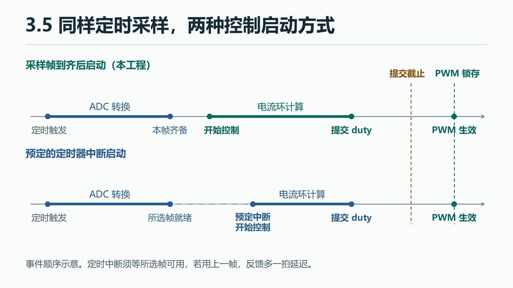
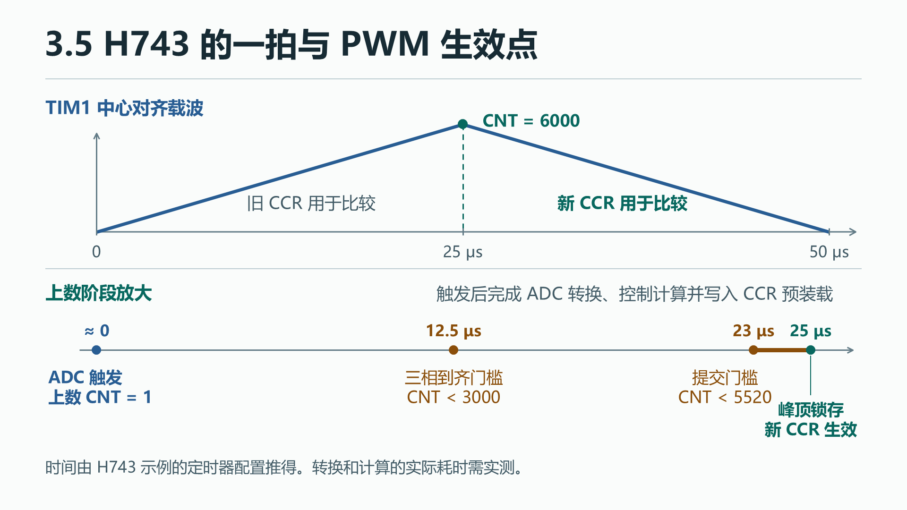

# 3.5 采样、中断与一拍控制

[上一节 3.4 电流与角度传感器](03-sensors.md) · [下一节 3.6 电零点与开环波形验算](05-transforms.md)

定时器可以固定采样间隔。要让控制可靠，还要知道本帧什么时候到齐，新占空比最晚什么时候能提交。

## 1.1 工程问题与通路

<span id="给离散控制的一拍标出三个时刻"></span>

<span id="把模型的一拍展开成采样和更新的时间轴"></span>

### 一拍里有哪些时间点

控制器需要以固定间隔采到电流。定时器可以在 PWM 周期的指定位置触发 ADC，但触发只是开始，转换完毕才有结果。算出来的 duty 也要等到指定更新点才能影响 PWM。以 `Ts=50 μs` 为例，每秒采样 20 000 拍，下面的事件都在每一拍内按次序发生。

| 事件 | 对应的模型量 | 部署时要确认 |
|---|---|---|
| 触发采样 | 本拍输入的时间参考 | 由定时事件选在载波的指定位置，确认实际模拟取样窗口与开关边沿的关系 |
| 三相结果齐备 | 可供算法使用的 `iabc[k]` | 等本组结果齐备再调用控制。角传感器更新较慢时，按时间戳选取反馈角 |
| 写入新比较值 | 本拍算得 `duty[k]` | 计算与提交必须赶在目标锁存事件之前，确认三相能在同一更新事件采用新值 |
| 新比较值锁存 | `duty[k]` 开始影响 PWM 比较 | 比较值在指定事件生效。需要研究控制延迟时，在模型中按生效相位设置输出保持或延时 |

### 两种控制启动方式

两条时间轴都从定时采样开始，区别在于哪一个事件启动控制。

[](../docs/assets/chapter-3/04-sampling-zero-01.png){: .diagram}

两种方式都可以让采样节拍固定。第一种把数据就绪作为控制开始的条件，转换耗时和中断响应仍会影响开始时刻。第二种要按最迟的数据就绪时刻安排定时器中断，并约定使用本帧还是上一帧。用上一帧时，反馈多一拍延迟。本例采用第一种方式，三相到齐后交给应用一次。

下图放大 H743 示例的载波上数阶段。提交门槛和锁存点的配置推导见 2.1，实测步骤见 2.2。

[](../docs/assets/chapter-3/04-sampling-zero-02.png){: .diagram}

## 1.2 高层代码领读

<span id="通用-foc-部署"></span>
<span id="通用部署"></span>

### 按调用顺序读一拍控制

控制代码把一次完整采样当成一次函数调用。`MotorApp_CurrentIsr(const uint16_t raw[3], uint32_t now)` 的 `raw` 是板级交来的三相计数，`now` 在这里是这组采样的触发参考时间。`const` 表示应用只读这份计数。函数先推进节拍、更新编码器并换算三相电流，再用本拍时间求反馈角。下面是它接上测量算法的几行。 [控制入口与测量链](https://github.com/pjzjwzx/foc-stm32-example/blob/chapter-3/app/motor_app.c#L462-L493)

**源码摘录**。

```c
float angle = rotor.valid ? Rotor_ElectricalAngle(&rotor, now) : 0.0f;
if (!isfinite(angle))
    angle = 0.0f;
if (!Foc_Measure(&foc, phase, angle))
    MotorApp_FaultIsr(APP_FAULT_MATH);
```

第一行的 `条件 ? 真值 : 假值` 用最近的有效角计算这一拍的电角。当前角无效或计算返回无效数值时，测量路径用 0 继续记录诊断。运行能否继续还受 `encoder_tick` 的健康与超时检查约束。最后两行将三相电流和角度交给 `Foc_Measure`，函数返回失败就记数学故障。之后由运行状态决定是否计算新的 duty。Open 用给定电角做逆 Park 和调制，算完才走板级提交。该提交失败也会进入故障处理。 [编码器保护](https://github.com/pjzjwzx/foc-stm32-example/blob/chapter-3/app/motor_app.c#L382-L413) · [Open 到 duty 提交](https://github.com/pjzjwzx/foc-stm32-example/blob/chapter-3/app/motor_app.c#L519-L549)

换 MCU 时，保留“拿到一组有效电流和采样时刻再运行一次控制”这个约定。硬件可以用转换完成中断、DMA 完成或其他方式交付结果。若目标硬件的通道依次采样，还要在接入前检查相间取样偏移。更换载波或触发配置后，重新确认每载波触发几次、控制实际周期和预装载截止点，再更新模型步长及控制代码里的 `dt`。 [示例的固定控制周期](https://github.com/pjzjwzx/foc-stm32-example/blob/chapter-3/config/lab_config.h#L18-L29)

把最迟的帧到齐时刻和最早的提交截止时刻相减，所得时间供控制代码和可能插入的更高优先级中断使用。先定义整帧如何识别、何时过期、失败时怎样停止更新或关断，再用目标平台的计时手段验证。后面的 H743 时间轴把这些条件写成具体的计数器窗口。

## 2.1 BSP 与 CubeMX 领读

<span id="stm32-部署示例"></span>
<span id="stm32-实现"></span>

### 先跟代码走完 H743 的一拍

在 [3.2 的 TIM1 计数图](01-pwm-svpwm.md) 上沿 CNT 看一圈。从底端上数到 1 时，CH4 的 OC4REF 产生下降沿，经内部 TRGO 触发三个 ADC 的注入转换。到达顶端约需 25 μs，再下数约 25 μs 回到底端。ADC 选下降沿，所以一整个 50 μs 载波只取一组触发。 [TIM1 触发路由](https://github.com/pjzjwzx/foc-stm32-example/blob/chapter-3/Core/Src/tim.c#L45-L99) · [ADC 注入边沿](https://github.com/pjzjwzx/foc-stm32-example/blob/chapter-3/Core/Src/adc.c#L82-L101)

**示意时间轴**。以载波底端为 0，表中的数字来自配置或手算，ADC 与控制运行的具体耗时需实测。

| 从底端起 | 硬件与程序经过哪里 |
|---|---|
| 上数到 1，约 0.004 μs | CH4 下降沿经 TRGO 启动三路注入。该位置是代码用来回推的触发参考 |
| 注入结果陆续完成 | ADC1/2 共用 `ADC_IRQHandler`，分别调用两个句柄的 `HAL_ADC_IRQHandler`。ADC3 的 `ADC3_IRQHandler` 调用 ADC3 句柄。HAL 读取各自完成标志，进入同一个 BSP 完成回调 |
| 上数且 CNT 小于 3000，约 12.5 μs 内 | 回调的三位标志都置上后读取三路 `JDR1`，确认完成窗口，清位图并调用一次应用 |
| 上数且 CNT 小于 5520，约 23 μs 前 | 运行分支完成控制，`Board_ApplyDutyIsr` 核对 duty、驱动和计数相位后把三相写入 CCR 预装载。超过提交窗口会返回失败，应用走故障关桥 |
| 顶端 CNT 为 6000，约 25 μs | TIM1 更新事件采用新比较值。提交检查在顶端前留了约 2 μs |
| 下数到底，约 50 μs | 进入下一完整载波。若期间没有新的写入，比较值继续保持 |

[两条 IRQ 入口](https://github.com/pjzjwzx/foc-stm32-example/blob/chapter-3/Core/Src/stm32h7xx_it.c#L261-L343) · [BSP 注入完成回调](https://github.com/pjzjwzx/foc-stm32-example/blob/chapter-3/bsp/board.c#L298-L323) · [提交检查与写入](https://github.com/pjzjwzx/foc-stm32-example/blob/chapter-3/bsp/board.c#L104-L135)

**源码摘录**。完成回调先记录是哪路 ADC 报到。

```c
uint8_t bit = h == &hadc1 ? 1U : h == &hadc2 ? 2U : 4U;
if (adc_done_mask & bit)
{
    adc_done_mask = 0;
    MotorApp_FaultIsr(APP_FAULT_SAMPLE);
}
adc_done_mask |= bit;
```

`h` 是 HAL 交给回调的 ADC 句柄地址。`1U、2U、4U` 分别是 `001、010、100`，`&` 检查这一位原来有没有置上，`|=` 保留其他位并置上本位。假设完成顺序为 ADC2、ADC1、ADC3，位图依次为 `010 → 011 → 111`，到 7 才进入读数和计算。如果 ADC2、ADC1 之后又到 ADC2，第三次发现重复，清旧位图并报告采样故障，再记录新 ADC2，仍未到齐。 [位图汇合](https://github.com/pjzjwzx/foc-stm32-example/blob/chapter-3/bsp/board.c#L298-L310)

**源码摘录**。以下为三相齐备后的时间检查和调用。

```c
uint32_t now = BSP_GetTimeUs(), count = TIM1->CNT;
if ((TIM1->CR1 & TIM_CR1_DIR) || count >= TIM1->ARR / 2U)
{
    adc_done_mask = 0;
    MotorApp_FaultIsr(APP_FAULT_SAMPLE);
    return;
}
uint32_t trigger_time =
    now - (count > 1U ? (count - 1U) / (BOARD_TIM1_CLOCK_HZ / 1000000U) : 0U);
adc_done_mask = 0;
MotorApp_CurrentIsr(raw, trigger_time);
```

`TIM1->CNT` 通过寄存器地址读取计数，`DIR` 位为 1 表示下数。处在下数段或已经到达上数 3000 格，都会报故障并在调用应用前返回。窗口通过后，以每微秒 240 个计数回推上数到 1 的时刻。若软件时钟读到 12 345 μs，计数为 1201，手算得到 `(1201−1)/240 = 5 μs`，交给应用的是 12 340 μs。两次寄存器读数有先后，整数除法也会舍去余数。这个结果供反馈角对齐时间，实际 ADC 模拟取样窗口和转换完成时刻仍须各自核对。应用返回后，回调返回 HAL，HAL 完成本次中断处理，再回到中断前的代码。 [回推与调用](https://github.com/pjzjwzx/foc-stm32-example/blob/chapter-3/bsp/board.c#L307-L323)

### 再回查 CubeMX 和生成代码

下表沿触发、接收、完成通知列出 **Timers → TIM1** 与 **Analog → ADC1/ADC2/ADC3** 的设置和生成的 C 字段。 [示例 .ioc](https://github.com/pjzjwzx/foc-stm32-example/blob/chapter-3/FOC_Arclab_H743_V3.ioc)

| CubeMX 设置 | 本工程取值 | 生成代码 |
|---|---|---|
| TIM1 Counter Settings、Channel 4 | 240 MHz，PSC=0，中心对齐 3，ARR=6000，RCR=0。CH4 用 PWM1、Pulse=1，只作内部触发 | `Period = PWM_COUNT-1`、`RepetitionCounter = 0`、CH4 的 `Pulse = 1`。[TIM1 初始化](https://github.com/pjzjwzx/foc-stm32-example/blob/chapter-3/Core/Src/tim.c#L45-L99) |
| TIM1 Trigger Output | TRGO 选 OC4REF，将 CH4 参考信号送给 ADC | `MasterOutputTrigger = TIM_TRGO_OC4REF`。[TRGO 赋值](https://github.com/pjzjwzx/foc-stm32-example/blob/chapter-3/Core/Src/tim.c#L65-L67) |
| ADCx Injected Conversion | 三个 ADC 均启用单端 Injected Rank 1，每组一次转换序列，外部触发 Timer 1 TRGO、Falling Edge。通道依次为 IN5、IN7、IN0 | `InjectedNbrOfConversion = 1`、`ADC_EXTERNALTRIGINJEC_T1_TRGO`、`ADC_EXTERNALTRIGINJECCONV_EDGE_FALLING`。[ADC1](https://github.com/pjzjwzx/foc-stm32-example/blob/chapter-3/Core/Src/adc.c#L82-L100) · [ADC2](https://github.com/pjzjwzx/foc-stm32-example/blob/chapter-3/Core/Src/adc.c#L161-L179) · [ADC3](https://github.com/pjzjwzx/foc-stm32-example/blob/chapter-3/Core/Src/adc.c#L227-L245) |
| ADCx 采样和过采样 | ADC 内核 36 MHz，分辨率 14 bit，单次取样时间 2.5 ADC 周期。注入组累加 16 次，结果右移 2 位 | `ADC_RESOLUTION_14B`、`ADC_SAMPLETIME_2CYCLES_5`、`Ratio = 16`、`ADC_RIGHTBITSHIFT_2`。[ADC1 配置](https://github.com/pjzjwzx/foc-stm32-example/blob/chapter-3/Core/Src/adc.c#L50-L100) · [ADC 时钟](https://github.com/pjzjwzx/foc-stm32-example/blob/chapter-3/FOC_Arclab_H743_V3.ioc#L399) |
| NVIC Settings | 启用 ADC1/2 共用中断与 ADC3 中断，抢占优先级都为 1 | `HAL_NVIC_SetPriority(ADC_IRQn, 1, 0)`、`HAL_NVIC_SetPriority(ADC3_IRQn, 1, 0)` 和各自的 `HAL_NVIC_EnableIRQ`。[NVIC 代码](https://github.com/pjzjwzx/foc-stm32-example/blob/chapter-3/Core/Src/adc.c#L286-L338) |

ADC 的 2.5 个时钟周期描述单次模拟取样时间，之后还要转换并累加。本例 ADC1 的 EOC 选择为序列完成，HAL 的注入中断使用 JEOS。ADC2/3 的 EOC 选择为单次完成，注入中断使用 JEOC。三个注入组各只有一个 Rank，两种完成通知都能标记本相本拍结果。BSP 的 `Board_Start` 先用 `HAL_ADCEx_InjectedStart_IT` 为三路注入组准备中断和触发，再启动 TIM1 三相与 CH4。任一 HAL 调用失败就返回 `false`，由主函数进错误处理。 [板级启动](https://github.com/pjzjwzx/foc-stm32-example/blob/chapter-3/bsp/board.c#L175-L192) · [主函数](https://github.com/pjzjwzx/foc-stm32-example/blob/chapter-3/Core/Src/main.c#L73-L135)

母线电压也在 ADC1，但接 PC5/IN8，使用规则组 Rank 1、软件启动、64.5 ADC 周期采样。后台每隔至少 1000 μs 启动一次，到规则 EOC 才读结果并换算伏数。代码用 `HAL_ADCEx_RegularStop` 结束规则组，让注入组继续接受 TIM1 触发。母线数据超过新鲜窗口后 `Board_BusVoltage()` 返回 0。三相注入结果和母线规则结果有各自的寄存器与读取路径。 [规则组配置](https://github.com/pjzjwzx/foc-stm32-example/blob/chapter-3/Core/Src/adc.c#L50-L114) · [后台母线读取](https://github.com/pjzjwzx/foc-stm32-example/blob/chapter-3/bsp/board.c#L194-L225)

## 2.2 LAB 实机操作与验收

<span id="实物选做先验证节拍再对齐"></span>

### 实物选做｜验证采样与提交节拍

1. 用 LAB4（`LAB_STAGE=4`）构建并下载。保持 Disabled，先核对上一节的电流零偏和编码器。以独立计时观察 `MotorApp_Diagnostics.current_ticks`，正常应约每秒增加 20 000。若有示波器，可用另加的 GPIO 探针观察 IRQ 和提交相对载波的时刻。诊断量 `max_isr_cycles` 记录应用控制函数内部耗时，整条链还包含采样和中断入口开销。断点会暂停程序，计时记录应在连续运行时取得。 [诊断字段](https://github.com/pjzjwzx/foc-stm32-example/blob/chapter-3/app/motor_app.h#L29-L42)

2. 在符合 3.3 的供电、限流、空载和停机条件时，短时进入 Open，记录一个 PWM 载波周期内的触发参考、应用入口与 CCR 提交位置。示波器上对照 PWM 载波与诊断探针，确认每载波只产生一次应用调用、三相齐备后才计算、提交留在上数窗口内。需要检查预装载锁存时，可用已知占空比变化，对照提交探针和引脚波形变化。发生节拍异常、提交超时或故障时停止输出。触发与提交的实板记录待补。 [3.3 启停条件](02-open-loop.md) · [验证记录](reference.md#验证记录)

<span id="给真实电角定义零点"></span>
<span id="用-lab4-标定电零点"></span>

电角基准、LAB4 对齐与保存检查见 [3.6 电零点标定](05-transforms.md#用-lab4-标定电零点)。
