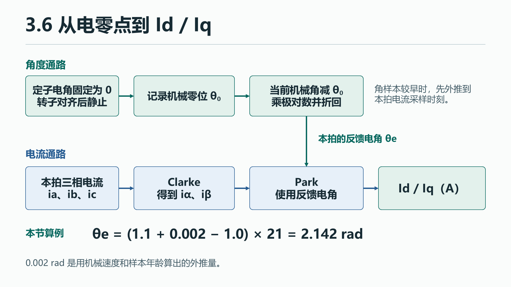

# 3.6 电零点与开环波形验算

[上一节 3.5 采样、中断与一拍控制](04-sampling-zero.md) · [下一节 3.7 电流闭环与初步调试](06-current-pi.md)

先用对齐建立电角基准，再在电压开环中验证三相电流和角度是否能支撑闭环计算。

## 1.1 工程问题与通路

### 给真实电角定义零点

编码器的机械零刻度由安装位置决定。把定子电压矢量固定在程序约定的电角 0，给 d 轴小电压且 q 轴为 0，等待能自由转动的转子对齐并静止。此时的机械角记为 `θ0`。完成对齐后，若不考虑样本延迟，反馈电角就是 `wrap((θm − θ0) × p)`，其中 `p` 是极对数。

[](../docs/assets/chapter-3/05-transforms.png){: .diagram}

电流零偏与电零点各减在自己的量上。电流减 ADC 基线后乘 A/count，电角先减对齐得到的机械角再乘极对数。角样本比这拍电流更早时，还会在机械角上加 `速度 × 样本年龄`，然后减零位、乘极对数、折回一圈。 [电角计算](https://github.com/pjzjwzx/foc-stm32-example/blob/chapter-3/control/rotor.c#L71-L80)

**手算输入**。机械零位为 1 rad，最近机械角为 1.1 rad，样本比电流触发早 200 μs，机械速度 10 rad/s，电机有 21 极对。**答案**　先外推 `10 × 0.0002 = 0.002 rad`，再算 `(1.1 + 0.002 − 1) × 21 = 2.142 rad`，已在一圈以内。

## 1.2 高层代码领读

<span id="通用-foc-部署"></span>
<span id="通用部署"></span>

### 单点对齐怎样产生零位

应用收到请求后检查阶段至少为 LAB4、当前 Disabled、无故障、编码器已有足够有效帧、母线电压与标定电压满足条件。驱动准备成功后调用 `Calibration_Start`，本次 `lut` 参数为假。应用随后发布 `APP_CALIBRATION` 状态。电流中断每拍推进 `Calibration_FastStep`。它用 4000 拍在 0.2 s 内将 d 轴电压爬到目标，保持电角 0，等待 10 000 拍即 0.5 s，再开始接收 256 个有效新角。按 4 kHz 名义频率计，取样约需 64 ms。此时的 `Foc_VoltageStep` 用 d 轴对齐电压、q 轴 0 V。 [请求检查](https://github.com/pjzjwzx/foc-stm32-example/blob/chapter-3/app/motor_app.c#L241-L284) · [标定状态机](https://github.com/pjzjwzx/foc-stm32-example/blob/chapter-3/app/calibration.c#L10-L83) · [应用输出电压](https://github.com/pjzjwzx/foc-stm32-example/blob/chapter-3/app/motor_app.c#L508-L517)

**源码摘录**。每次收到有效新角，`Calibration_OnSample` 在收样阶段累计方向归一化后的计数。以下省略第一帧设置 `first_count` 的分支，后面的 LUT 分支留到专题。

```c
c->sum += (int64_t)c->first_count + delta(raw, c->first_count);
if (++c->samples < CAL_SAMPLES)
    return;
uint16_t mean = (uint16_t)(c->sum / (int64_t)CAL_SAMPLES);
if (!c->lut_mode)
{
    c->result.zero_count = mean;
    c->result.zero_valid = 1;
    c->result.lut_valid = 0;
    c->state = CAL_PROCESS;
    return;
}
```

`delta` 求相对于第一帧的环形短差。`++c->samples` 先加一再比较，前 255 帧累加后就返回。第 256 帧得到整数平均，保存为机械零位，标记电零点有效和 LUT 无效。后台见到 `CAL_PROCESS` 就先关桥，再处理、保存并读回验证。成功后才把结果交给 `rotor`，并等一个新角重新建立反馈。失败时记录标定故障。接下来用已标定电角检查 Park，完整扫圈和查表放到 [LUT 专题](09-lut.md)。 [圆周差与单点结果](https://github.com/pjzjwzx/foc-stm32-example/blob/chapter-3/app/calibration.c#L19-L105) · [关桥和保存](https://github.com/pjzjwzx/foc-stm32-example/blob/chapter-3/app/motor_app.c#L587-L609) · [Flash 读回](https://github.com/pjzjwzx/foc-stm32-example/blob/chapter-3/bsp/flash_store.c)

**离线过关**。把 65534、0、2 当成仅用于演算的三个对齐样本。相对首点展开后为 65534、65536、65538，平均为 65536，折回全圈计数后是 0。这个例子用来检验平均前的跨圈展开。

### 用一组输入核对 Clarke 和 Park

示例固件每次收齐一组电流采样，就把三相电流和按本拍时间计算的反馈电角送给变换函数。

**源码摘录**。输入通过检查后，`Foc_Measure` 先保存三相电流，再执行下面三句。函数开头的检查和复制省略。 [Foc_Measure](https://github.com/pjzjwzx/foc-stm32-example/blob/chapter-3/control/foc.c#L78)

~~~c
Foc_Clarke(phase_A, &foc->alpha_current_A, &foc->beta_current_A);
Foc_Park(foc->alpha_current_A, foc->beta_current_A, angle, &foc->id_A, &foc->iq_A);
return isfinite(foc->id_A) && isfinite(foc->iq_A);
~~~

- `phase_A` 按 A、B、C 顺序存放三相电流，单位 A。Clarke 把它们写成固定坐标的 α、β 两个分量。`&` 将字段的地址传给函数，函数用 `*alpha`、`*beta` 将结果写到调用者指定的位置。
- Park 用刚算出的 α、β 和 `angle` 旋转坐标轴。这个角是反馈电角，单位 rad。两个结果通过地址写进 `foc->id_A`、`foc->iq_A`，单位仍是 A。
- 两个结果都是有限数才返回 `true`。空指针、非有限输入或输出返回 `false`。应用收到失败后记录数学故障并关桥。 [变换定义](https://github.com/pjzjwzx/foc-stm32-example/blob/chapter-3/control/foc.c#L27) · [应用调用和失败处理](https://github.com/pjzjwzx/foc-stm32-example/blob/chapter-3/app/motor_app.c#L489)

**手算输入**。选同一时刻的 `[ia, ib, ic] = [1, −0.5, −0.5] A` 和反馈电角 `θe = π/2 rad`。按源码中的公式计算如下。

~~~text
iα = (2ia − ib − ic) / 3       = 1 A
iβ = (ib − ic) / √3           = 0 A
Id =  iα cos θe + iβ sin θe    = 0 A
Iq = −iα sin θe + iβ cos θe    = −1 A
~~~

把坐标轴旋转 90° 后，原来指向正 α 轴的电流在新坐标里指向负 q 轴。用同一个角做逆 Park 会得到原来的 `[iα, iβ] = [1, 0] A`。如果模型在这组输入上得出 `Iq = +1 A`，先查它的 q 轴定义、Park 角度方向和 A/B/C 顺序。

### 同一拍有两条角度通路

**执行示意**。上路测量这一拍的电流，下路生成开环电压。

~~~text
实测 ia/ib/ic → Clarke → Park（反馈电角）→ Id/Iq
给定速度 × 周期 → 累加给定电角 → 逆 Park（给定电角）→ SVPWM → duty
~~~

在 `APP_OPEN` 中，`open_angle` 按命令推进。以 10 电 rad/s 和 50 μs 为例，一拍增加约 0.0005 rad。随后 `Foc_VoltageStep(&foc, open_angle, 0, reference.vq_V, bus)` 用给定角调制。仅在离线回放里改反馈角时，Id/Iq 会变化，按原给定重算的 duty 保持原值。实物运行中的传感器健康和故障检查仍然有效。 [开环分支](https://github.com/pjzjwzx/foc-stm32-example/blob/chapter-3/app/motor_app.c#L519) · [逆变换和调制](https://github.com/pjzjwzx/foc-stm32-example/blob/chapter-3/control/foc.c#L108)

### 怎样看出开环数据可用于闭环

一段**已知正确的输入**可以用来理解 dq 波形。设三相电流的峰值为 `I`、A 相电流相位为 `φ`，则三相输入为 `I·cos φ`、`I·cos(φ−2π/3)`、`I·cos(φ+2π/3)`。本工程的 Clarke 得到 `iα=I·cos φ`、`iβ=I·sin φ`。若反馈电角在整个区间为 `φ+δ`，其中 `δ` 固定，Park 的结果就是 `Id=I·cos δ`、`Iq=−I·sin δ`。改变 `δ` 会改变两条 dq 曲线的稳态值。若反馈角方向反了，dq 就会随转动摆动。

## 2.1 BSP 与 CubeMX 领读

<span id="stm32-部署示例"></span>
<span id="stm32-实现"></span>

### 角度样本、零位存储与遥测

3.4 的 SPI 编码器驱动把有效角度和请求时间戳交给应用。3.5 的采样回调交付电流帧及其触发参考时间。应用以这次电流采样为基准估算电角，再进入变换。单点标定成功后，后台在关桥状态调用板级保存接口并读回校验，Flash 路径见 3.11。 [编码器取样](03-sensors.md#tle5012-角度怎样交给应用) · [采样时间](04-sampling-zero.md) · [Flash 读回](09-lut.md#在关桥之后保存并验证)

UART4 在 LAB4 的六个遥测通道依次发布 `ia, ib, ic, Id, Iq, 反馈电角`。若还需要给定电角，诊断结构的 `open_angle_rad` 提供这个量。 [遥测通道](https://github.com/pjzjwzx/foc-stm32-example/blob/chapter-3/app/motor_app.c#L414-L493)

## 2.2 LAB 实机操作与验收

### 用 LAB4 标定电零点

在配套固件目录先运行离线命令。它打印开始帧 `0x124  05 01 01 90 00 00 00 00`，其中 `05` 选单点对齐，`01 90` 表示 400 mV。

```powershell
python tools/can_demo.py cal-zero --voltage-mv 400
```

#### 上板对齐与检查

按 3.5 的方法先确认采样节拍，用 LAB4（`LAB_TRANSFORMS`）构建并下载。保持 Disabled，确认三相零偏已完成且编码器工作正常。 [采样与提交节拍](04-sampling-zero.md#实物选做验证采样与提交节拍)

确认电机配置、机械自由转动条件、空载、母线和停机方法。按 [3.3 的 CAN 步骤](02-open-loop.md) 选适配器，例中把 `COM5` 换成实际端口。标定中有异常电流、故障或机械卡滞时立即停机并检查。

```powershell
python tools/can_demo.py --send --interface slcan --channel COM5 --bitrate 1000000 cal-zero --voltage-mv 400
```

等脚本轮询完成并停机。在脚本打印的完成回包中检查 `flags`。零位有效位 `0x08` 应置位，LUT 有效位 `0x01` 应清零。可用相同适配器和 `--send` 选项执行 `cal-read --index 0xFF`，在 Disabled 下读取电零点计数并在重启后核对。0.4 V 是本页的请求示例，实际能否对齐与供电、摩擦、负载及电机配置有关。 [标定轮询与读回工具](https://github.com/pjzjwzx/foc-stm32-example/blob/chapter-3/tools/can_demo.py#L193-L276) · [零位读取条件](https://github.com/pjzjwzx/foc-stm32-example/blob/chapter-3/app/motor_app.c#L285-L303)

### 记录 LAB4 开环波形

沿用 LAB4 和上面校验过的电零位。示例在三相 ADC 到齐后换算电流，用本拍采样的触发参考时刻计算反馈电角，再调用 `Foc_Measure`。按 3.3 完成启停和 UART4 观察的准备。LAB4 的 JustFloat 六通道依次为 `ia, ib, ic, Id, Iq, 反馈电角`。导出这六条后可用前三相离线重算 αβ。要比较给定角与反馈角的相位差，另外记录 `MotorApp_Diagnostics.open_angle_rad`，并与电流记录对齐时基。 [电流中断和遥测](https://github.com/pjzjwzx/foc-stm32-example/blob/chapter-3/app/motor_app.c#L414-L493) · [3.3 开环部署和 UART4](02-open-loop.md)

先离线确认短时低压开环命令，再按 3.3 的供电、限流、空载和停止条件决定是否实发。下面命令只生成报文和启停计划。

~~~powershell
python tools/can_demo.py open --electrical-speed 10 --vq 0.2 --duration 2
~~~

开环转动后保存一个稳态区间，用同一组三相和反馈电角重算 αβ、Id/Iq，再把 Id/Iq 叠到 LAB4 的波形上。把同步条件和最先出现不一致的信号写进记录。若 0.2 V 未带动转子，记录这一现象并停机检查运行条件。出现异常电流、振动或跟随丢失时，停止输出再排查。配套工程的实板结果待记录。 [验证记录](reference.md#验证记录)


开环起步后取一段稳定记录。将电流、反馈角、给定角的时间轴对齐。跨过 0 的角度先展开，比较方向和斜率。下面是**观察判据**，实际幅值受电机、电压、负载及采样影响。

| 看哪几条波形 | 一段可用于继续验证的记录 | 优先排查 |
|---|---|---|
| 三相电流 `ia/ib/ic` | 电机同步转动且绕组均衡时，三相通常围绕零值，幅值相近、相位依次差约 120 电角度，三相和接近零。开关纹波和失真允许存在 | 静止时已偏移就查零偏。单相幅值特别小或过大就查通道、量程和换算。电流符号全反时，三相和仍可能为零 |
| Clarke 的 `iα/iβ` | 平衡且近似正弦时，两条曲线的幅值接近、相差约 90 电角度，αβ 平面上的轨迹近圆 | 三相输入相同但 αβ 回放不一致时，查 Clarke 的系数、幅值约定和相序。轨迹有固定偏心或明显失真时，也检查三相输入 |
| 给定、反馈电角 | 同步跟随的区间中，展开后斜率和方向接近，允许相差一段角度。停住、持续滑移、换向或失步时，另选稳定区间 | 斜率反号查编码器方向和相序。倍率明显不符查机械角到电角的极对数。给定角动而反馈角基本不动时，先确认电机是否实际转动 |
| 用反馈角算出的 Id/Iq | 同步、稳速且电流基波均衡时，两条曲线常围绕某个值小幅变化。开环可出现非零 Id，Iq 的大小也随负载变化 | 先用记录的同一组三相和反馈角重算。重算吻合但稳态 dq 明显摆动时，回查相序、反馈角方向、角度倍率及取样对齐。固定电零偏移会旋转 dq，可用低压对齐来区分 |

回放时按同一时间戳依次比对三相 A、Clarke 的 αβ、Park 的 Id/Iq。先找到第一个对不上的中间量。若模型和固件都给出同样的异常波形，下一步查输入和运行条件。没有板时，可用自己的仿真波形做同样的逐列比较。
