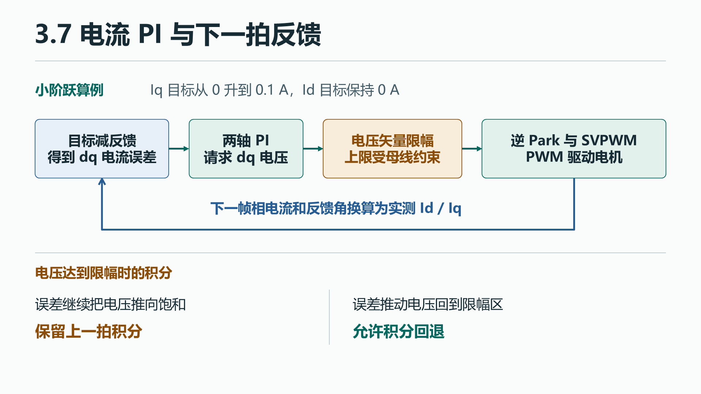

# 3.7 电流闭环与初步调试

[上一节 3.6 电零点与开环波形验算](05-transforms.md) · [下一节 3.8 固件分层与移植](06a-software-architecture.md)

开环验算通过后，可以让控制器根据实测电流调节电压。本节跟一拍 PI 的计算和限幅，再用小阶跃判断响应。

## 1.1 工程问题与通路

假设目标 Iq 比反馈大一点。控制器先根据误差增加 q 轴电压，逆变器施加新的电压，下一拍再看电流是否往目标移动。比例项对这一拍的误差立即响应，积分项记住此前还没有消除的误差。

{: .diagram}

母线能提供的电压有限。如果已经到上限，继续沿同一方向累加积分会让误差反向后仍推着输出顶在上限。程序用限幅前后的差值决定这一拍能否更新积分。

## 1.2 高层代码领读

### 从模型的电流误差找到 C 中的两只 PI

电流控制器为这一拍给出 Vd/Vq。实测三相电流经 Clarke、Park 得到 Id/Iq，用各自的目标减去反馈，得到两轴误差。示例在 Current 状态把命令写进控制对象，随后把本拍反馈电角和实测母线交给电流环。

**源码摘录**。ADC 采样已换算为 A，`Foc_Measure` 已更新反馈，母线与状态检查已通过。这里省略了开环、标定和速度等其他分支。 [电流环调用](https://github.com/pjzjwzx/foc-stm32-example/blob/chapter-3/app/motor_app.c#L541)

~~~c
if (state == APP_CURRENT)
{
    foc.id_ref_A = reference.id_A;
    foc.iq_ref_A = reference.iq_A;
}
ok = ok && Foc_CurrentStep(&foc, angle, bus);
~~~

`reference` 保存应用接受的最新命令，反馈在每拍重算。`ok &&` 先检查之前的操作是否成功，通过后才进入 `Foc_CurrentStep`。函数取目标和反馈，算出本拍电压及 duty，再把结果和是否成功交还给应用。 [电流环定义](https://github.com/pjzjwzx/foc-stm32-example/blob/chapter-3/control/foc.c#L134)

先只看一个轴。第 `k` 拍取误差 `e[k] = i_ref[k] − i[k]`。比例项 `Kp·e[k]` 随当前误差立即变化。积分候选值 `I_try = I_prev + Ki·Ts·e[k]` 把误差累加到上拍保存的积分，给出试算电压 `v_raw = Kp·e[k] + I_try`。当误差逐渐归零，已经存下的积分仍能提供维持目标电流所需的电压。接下来沿代码检查这次积分是否允许保存，以及输出最多能给多少电压。 [候选积分与输出](https://github.com/pjzjwzx/foc-stm32-example/blob/chapter-3/control/foc.c#L139-L155)

### 从电机参数得到第一组 PI 系数

先用低速的每轴电流近似 `v = R·i + L·di/dt`。它的电压到电流传递函数为 `1/(Ls+R)`。PI 的传递函数为 `Kp + Ki/s`。令 `Ki/Kp = R/L`，在这个简化模型中，PI 的零点抵消电流对象的极点，剩下的理想闭环是一阶，带宽为 `Kp/L`。选定带宽 `ωc` 后，用 `Kp = L·ωc`、`Ki = R·ωc` 起步。d、q 轴用各自的电感，同用相电阻。反电动势、轴间耦合、采样和计算延迟都会影响实机的响应，需要用小电流阶跃核对。

| 量 | C 中如何使用 | 单位及默认 GB7215 例子 |
|---|---|---|
| 比例系数 Kp | 初始化 `id_pi.kp`、`iq_pi.kp`，每拍乘对应的误差 | V/A。L = 0.00073 H、ωc = 1000 rad/s，得到 0.73 V/A |
| 积分系数 Ki | 初始化两轴 `pi.ki`，每拍乘误差和控制周期 | V/(A·s)。R = 1.3 Ω，得到 1300 V/(A·s) |
| 控制周期 Ts | `FOC_CURRENT_DT_S`，每次积分乘一次 | 1/20000 s = 50 μs，故 Ki·Ts = 0.065 V/A |
| 积分状态 | `pi.integral`，跨拍保留，停机或故障时清零 | V。可以直接与比例项相加 |

离散步长决定单拍积分增量。示例把连续 Ki 保存为 1300，再在每拍乘 Ts。如果模型的离散块已把 Ki·Ts 预乘到系数中，核对单拍增量时只乘一次 Ts。 [初始化和复位](https://github.com/pjzjwzx/foc-stm32-example/blob/chapter-3/control/foc.c#L55) · [电机参数](https://github.com/pjzjwzx/foc-stm32-example/blob/chapter-3/config/motor_config.h#L25) · [周期定义](https://github.com/pjzjwzx/foc-stm32-example/blob/chapter-3/config/lab_config.h#L24)

### 跟一拍离散积分、限幅和调制

函数入口检查反馈角、目标、反馈、运行限流和母线是否有效。它先限制电流目标，GB7215 的 Id 上限为 ±5 A，Current 进入时 Iq 运行限流为 ±1 A。接着从目标减反馈，两轴各计算候选积分和未限幅的电压。 [电流目标与电压计算](https://github.com/pjzjwzx/foc-stm32-example/blob/chapter-3/control/foc.c#L134) · [模式切换初始化](https://github.com/pjzjwzx/foc-stm32-example/blob/chapter-3/app/motor_app.c#L150)

**源码摘录**。展示 q 轴对应的计算行，d 轴和后续检查见链接中的完整函数。

~~~c
float next_q = foc->iq_pi.integral + foc->iq_pi.ki * FOC_CURRENT_DT_S * eq;
float raw_q = foc->iq_pi.kp * eq + next_q;
~~~

`next_q` 是这拍的候选积分，`raw_q` 是用候选积分得到的电压。此时历史积分还未更新。两轴共用一个电压圆，半径取 `min(12 V, 0.95·Vbus/√3)`。Vbus 为 24 V 时取 12 V。如果未限制的电压为 `(9, 12) V`，模长 15 V，给两轴同时乘 12/15，得到 `(7.2, 9.6) V`，保留了电压方向。 [电压上限和矢量缩放](https://github.com/pjzjwzx/foc-stm32-example/blob/chapter-3/control/foc.c#L90)

**源码摘录**。矢量试限幅后，`vd/vq` 保存试限幅结果。

~~~c
if (ed * (raw_d - vd) <= 0.0f) foc->id_pi.integral = Clamp(next_d, -limit, limit);
if (eq * (raw_q - vq) <= 0.0f) foc->iq_pi.integral = Clamp(next_q, -limit, limit);
vd = foc->id_pi.kp * ed + foc->id_pi.integral;
vq = foc->iq_pi.kp * eq + foc->iq_pi.integral;
return Foc_VoltageStep(foc, angle, vd, vq, bus_voltage_V);
~~~

1. `raw_q - vq` 是试限幅去掉的 q 轴电压。没限到时差为零，允许更新积分。限到后，如果误差仍把电压往同一方向推，乘积为正，保留旧积分。如果误差反向，允许积分往回退。
2. d 轴也按自己的误差与被削掉的电压判断。接受的新积分还要限制到 `[-limit, limit]`。这就是本工程的条件积分抗饱和。
3. 用实际保存的两个积分重算 Vd/Vq，交给 `Foc_VoltageStep`。它再次检查并限制电压，接着沿 3.2 的逆 Park 和 SVPWM 得到三相 duty。最终返回值回到应用调用行。 [积分写回](https://github.com/pjzjwzx/foc-stm32-example/blob/chapter-3/control/foc.c#L158) · [电压到 duty](https://github.com/pjzjwzx/foc-stm32-example/blob/chapter-3/control/foc.c#L108)

**手算输入**。默认 GB7215，母线 24 V，反馈电角 0，三相 ADC 读数等于零偏，旧积分为 0，目标 `Id=0 A、Iq=0.1 A`。这组值用于模型和 C 的离线对照。

| 计算位置 | 第一拍结果 |
|---|---|
| ADC 减零偏后，经 Clarke/Park | 三相 0 A，Id 和 Iq 都为 0 A |
| 目标减反馈，候选积分 | ed = 0 A、eq = 0.1 A，q 轴候选积分 0.0065 V |
| 比例项加积分 | Vd = 0 V、Vq = 0.0795 V，电压未限幅 |
| 逆 Park、SVPWM | duty 约为 `[0.500000, 0.502869, 0.497131]` |

再单独核对饱和分支。取 `ed=0`、`eq=1 A`、旧 q 积分 11.5 V，其余条件相同。候选积分为 11.565 V，未限制 Vq 为 12.295 V。试限幅到 12 V 后，`eq·(raw_q−vq)` 为正，积分保留 11.5 V。用它重算的 12.23 V 在调制前再次限到 12 V。这三个值分别对应积分候选、实际保存的积分与限幅后的输出。

## 2.1 BSP 与 CubeMX 领读

### 同一拍把 duty 交给 TIM1

**执行示意**。沿 3.5 的触发和三相帧汇合进入应用，电流运算成功后才尝试写定时器。

~~~text
ADC 帧 → 减零偏并换算 A → Clarke/Park → 电流 PI
      → 电压矢量限幅 → 逆 Park/SVPWM → duty → TIM1 CCR1/2/3
~~~

**源码摘录**。这是运行分支末尾。 [应用提交](https://github.com/pjzjwzx/foc-stm32-example/blob/chapter-3/app/motor_app.c#L548)

~~~c
if (running() && (!ok || !Board_ApplyDutyIsr(foc.duty)))
    MotorApp_FaultIsr(APP_FAULT_SAMPLE);
~~~

`running()` 为真且算法成功时，应用才调用板级提交。BSP 检查 duty 的范围和有限性，然后在短临界区检查驱动就绪、故障脚、计数方向和截止点。通过后按 PWM2 的极性将 `(1−duty)×ARR` 截断成整数，依次写三个 CCR，再打开 TIM1 总输出允许。本页手算的 duty 对应 `3000、2982、3017`。预装载值在更新事件生效。 [板级提交和 CCR 写入](https://github.com/pjzjwzx/foc-stm32-example/blob/chapter-3/bsp/board.c#L104)

TIM1 以 240 MHz 中心对齐计数，上数到 6000 需 25 μs，下数再需 25 μs。**50 μs 是 PI 周期**。CH4 在接近底端的上数 1 触发 ADC，CCR 提交要求上数且 `CNT < 5520`，给上端点预留 480 格即 2 μs。从底端到门槛约 23 μs，这段预算包含采样、转换、中断和计算。3.5 的三相回调还有独立的到齐检查。 [TIM1 配置](https://github.com/pjzjwzx/foc-stm32-example/blob/chapter-3/Core/Src/tim.c#L30) · [三相汇合](https://github.com/pjzjwzx/foc-stm32-example/blob/chapter-3/bsp/board.c#L298)

假设 duty 合法、驱动正常且计数向上。提交时 `CNT=5000` 会写入 CCR，函数返回 true，应用继续记录诊断。到 `CNT=5520` 时板级拒绝写入并返回 false，应用报采样故障。算法提前返回 false 时，`!ok` 让本拍跳过板级提交，同样走关桥。故障处理会清目标和积分。若三相换算时已发现过流，关桥在前，运行状态检查会阻止本拍提交。 [故障与复位](https://github.com/pjzjwzx/foc-stm32-example/blob/chapter-3/app/motor_app.c#L53)

## 2.2 LAB 实机操作与验收

### 用阶跃核对参考、反馈和饱和

在电脑用表中的同一组电流、角度、母线和初值对照模型与 C。已有配套工程的读者也可以运行 `python tools/check.py`。实机用 LAB5（`LAB_CURRENT_PI`），先确认电零位有效、开环方向与电流极性已核对。按 3.3 的条件准备低电压、限流、短时启停。先运行离线命令观察报文，再决定是否按实物步骤发送。

~~~powershell
python tools/can_demo.py current --id 0 --iq 0.1 --duration 1
~~~

1. 记录基线设置，按 3.3 选择 CAN 适配器并确认停机方法。若执行实发，从适合该电机的小 Iq 短时阶跃开始。固定 Iq 会产生力矩，空载可能加速，观察速度并在异常时停机。
2. JustFloat 的六通道依次为 `Id_ref, Id, Iq_ref, Iq, Vd, Vq`。以记录到的 `Iq_ref` 变化时刻为阶跃起点。确认 Iq 的方向、Id 的偏离程度和电压余量，再按前面的表判断。UART4 的名义 1 kHz 遥测用于看趋势。需要判断短暂超调、积分写回或单拍提交时，分别补做快速记录或离线测试。`max_isr_cycles` 可辅助核对应用耗时。
3. 只有基线方向正确、响应稳定且有电压余量时，才用同一阶跃对比另一组初始增益。先停机，在 `config/motor_config.h` 小幅修改带宽并重建下载。把两次反馈叠在同一时间轴上，记录带宽、母线、负载和采样条件。如果超调或振荡恶化，停止输出并恢复已验证的设置。退出模式或故障时，`Foc_Reset` 会清掉旧目标和积分。实板结果待记录。 [遥测与诊断](https://github.com/pjzjwzx/foc-stm32-example/blob/chapter-3/app/motor_app.c#L442-L466) · [停机状态处理](https://github.com/pjzjwzx/foc-stm32-example/blob/chapter-3/app/motor_app.c#L116-L135) · [启停与观察步骤](02-open-loop.md) · [验证记录](reference.md#验证记录)

### 用小阶跃判断初始增益

先在模型或电脑上的测试中保持 `Id_ref=0`，给 Iq 参考一个小台阶。记下采样周期、母线、限幅、初始积分和电机参数。将参考、电流反馈和 Vd/Vq 画在同一时间轴上，读出响应方向、上升时间、超调、稳定后的误差以及电压是否贴住上限。先用未饱和的结果判断增益，再单独用离线饱和算例核对积分能否停止累加或在反向误差下退出饱和。 [限幅和积分写回](https://github.com/pjzjwzx/foc-stm32-example/blob/chapter-3/control/foc.c#L134-L155)

| 观察结果 | 下一轮怎么做 |
|---|---|
| Iq 一开始向相反方向走，或 Id 出现明显异常 | 先退出闭环，回查 3.6 的相序、电流方向、电零点和 Park 角度 |
| Vd/Vq 矢量持续接近电压上限 | 检查母线和限制，换一个更小的阶跃确认未饱和响应 |
| 响应缓慢且有电压余量 | 在模型中小幅提高带宽，比较上升时间和超调，再判断是否值得在板上验证 |
| 超调明显或有反复振铃 | 停机后先查采样到 PWM 的延迟，降低带宽，从基线条件重做 |
| 电流持续偏离目标且电压有余量 | 检查零偏、实际参考和积分写回，再在模型里单独改变 Ki 观察误差消退速度 |

在模型里分别改一次 Kp 或 Ki，观察比例项怎样改变初始响应、积分项怎样改变后续误差。上板的起始调整按固件的 `MOTOR_CURRENT_BANDWIDTH_RAD_S` 进行，它会按 `Foc_Init` 的公式同时更新 Kp 和 Ki。每轮只改这一个设置，保留原值，保持同一电机、母线、负载、目标和初始状态。先确认响应稳定，再比较快慢。 [带宽参数](https://github.com/pjzjwzx/foc-stm32-example/blob/chapter-3/config/motor_config.h#L51-L59) · [增益初始化](https://github.com/pjzjwzx/foc-stm32-example/blob/chapter-3/control/foc.c#L51-L72)
