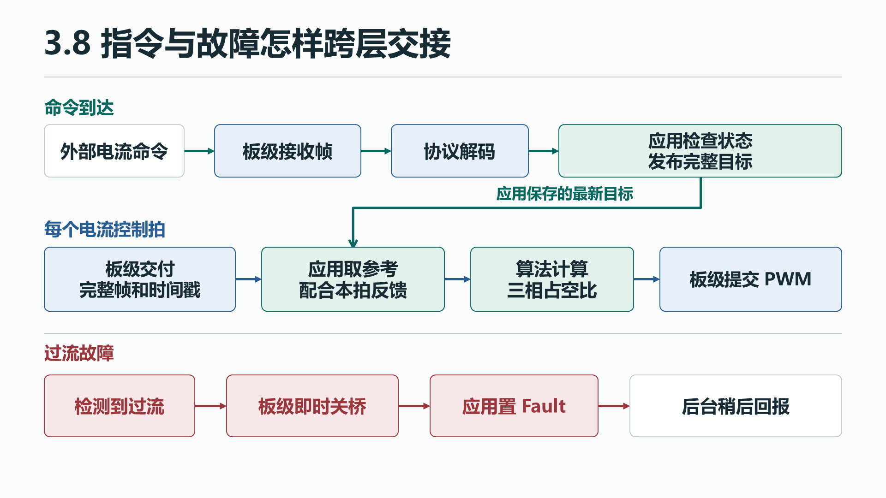

# 3.8 固件分层与移植

[上一节 3.7 电流闭环与初步调试](06-current-pi.md) · [下一节 3.9 速度环与多速率调度](07-speed.md)

沿一次命令和一次关断追踪各层的交接，就能判断换板时哪些接口要重接，哪些计算可沿用。

## 1.1 工程问题与通路

命令可能在两拍控制之间到达，采样和 PWM 又各有自己的时间。用一条电流指令和一次故障关断，看程序怎样在这些时刻交接。

{: .diagram}

- **算法的接口**接收明确的物理量和周期，例如 A、V、rad、s，保存积分等跨拍状态。输出电压或占空比，并报告能否使用。
- **应用的接口**负责哪个模式可以运行、哪个目标何时生效，以及检测到异常后采取什么动作。外部给定可能每 20 ms 才更新一次，内环依然每 50 μs 从完整目标和新反馈计算。
- **协议的接口**负责字节、字段和物理量互换。帧合法之后，还要交给应用判断是否允许执行。
- **板级的接口**把一组采样、时间戳和故障交给上层，接收 PWM 提交和即时关断的要求。采样完整性、提交截止点及故障响应时间要写进接口的使用条件。

## 1.2 高层代码领读

### 从已经见过的一行找层的边界

**源码摘录**。电流环算完 duty 后，应用用这一行决定能否提交。 [应用提交](https://github.com/pjzjwzx/foc-stm32-example/blob/chapter-3/app/motor_app.c#L548)

~~~c
if (running() && (!ok || !Board_ApplyDutyIsr(foc.duty)))
    MotorApp_FaultIsr(APP_FAULT_SAMPLE);
~~~

这一行连了三种职责。`running()` 属于应用，决定当前状态是否允许出力。`foc.duty` 是算法算出的三相比例。`Board_ApplyDutyIsr` 属于板级支持层，负责在合适的时刻将这组三相比例交给硬件。板级函数返回失败时，应用决定报哪类故障并调用关桥。这样写后，换控制算法时可以继续用同一个提交接口，换 PWM 硬件时可以保留应用的成功与失败分支。

共享数据也有接口。若后台逐字段写入新命令时被电流中断抢占，中断可能拿到新 Id 和旧 Iq。应把整份参考作为一次发布。后台读取反馈时也要在同一个时刻取得相互关联的量，例如 Iq、运行状态和故障位。可用短临界区复制少量字段，之后再完成发送。将跨环境的等待和耗时操作放在控制截止点之外。

### 沿一条电流命令走到下一拍

从 `Protocol_Decode()` 的输出开始。解码后的电流目标带 A 单位，接着交给 `MotorApp_AcceptCommand()`。在 `APP_CURRENT` 且无故障时，应用检查时间、限幅并发布整份参考。到了 `MotorApp_CurrentIsr()`，Current 分支从这份参考取出 `Id/Iq`，用当拍的反馈调用 `Foc_CurrentStep()`。相同的目标可以沿用多拍，每拍都要检查计算和 PWM 提交的结果。 [解码入口](https://github.com/pjzjwzx/foc-stm32-example/blob/chapter-3/communication/protocol.c#L29) · [应用接受命令](https://github.com/pjzjwzx/foc-stm32-example/blob/chapter-3/app/motor_app.c#L306) · [电流环调用](https://github.com/pjzjwzx/foc-stm32-example/blob/chapter-3/app/motor_app.c#L541)

再走一次过流分支。测得的相电流超出阈值时，`MotorApp_FaultIsr()` 调用板级关断，锁存故障并复位控制状态。后台稍后读取状态与故障快照，生成回复。这条路径的验收顺序是先确认功率输出已停止，再确认后台报告与应用状态一致。 [故障入口](https://github.com/pjzjwzx/foc-stm32-example/blob/chapter-3/app/motor_app.c#L53) · [后台入口](https://github.com/pjzjwzx/foc-stm32-example/blob/chapter-3/app/motor_app.c#L575)

**读代码的对照例。** 同一份合法目标到达时，Disabled 分支保留原参考和命令时间，Current 分支发布新参考并更新时间。若下一份反馈超限，板级关断先执行，应用再锁存故障，后台稍后发送状态。本拍失去运行许可。

### 用一帧电流目标串起调用

示例帧 `0x121 7F F8 06 00 00 00 00 00` 到达时，假设处于 Current、无故障且命令新鲜。

1. **解码。** `Protocol_Decode` 检查帧格式，从前三字节拆出两个 12 位整数 `0x7FF`、`0x806`。再按两个字段的协议量程还原为约 −0.00122 A 与 +0.09524 A。解码成功返回 true，后台才调用 `MotorApp_AcceptCommand`。完整帧格式见 3.10。 [解码定义](https://github.com/pjzjwzx/foc-stm32-example/blob/chapter-3/communication/protocol.c#L29) · [后台调用](https://github.com/pjzjwzx/foc-stm32-example/blob/chapter-3/app/motor_app.c#L611) · [3.10 CAN MIT](08-can-mit.md)
2. **接受。** 应用先以接收时间检查队列里的帧是否过期。对这帧再要求 `state == APP_CURRENT` 且无故障。在短临界区内，`reference = *cmd` 复制整份命令，接着限幅并更新 `last_command_us`。仅给变量加 `volatile` 只能约束访问，结构体的多个字段仍需要一起发布。若状态还在 Disabled，解码成功的这帧也会被应用拒绝，参考和命令时间都保持原值。 [命令入口](https://github.com/pjzjwzx/foc-stm32-example/blob/chapter-3/app/motor_app.c#L306) · [命令发布](https://github.com/pjzjwzx/foc-stm32-example/blob/chapter-3/app/motor_app.c#L342) · [临界区实现](https://github.com/pjzjwzx/foc-stm32-example/blob/chapter-3/bsp/board.c#L37)
3. **进入控制拍。** ADC 三相帧到齐后，Current 分支把参考复制到 `foc.id_ref_A`、`foc.iq_ref_A`。电流环再应用运行限流，结合新的反馈算出 duty。板级接口接收这组三相 duty 和提交请求。脚本每 20 ms 发一帧，正常情况下约每 400 个电流节拍收到一次新目标。 [电流环调用与 PWM 提交](https://github.com/pjzjwzx/foc-stm32-example/blob/chapter-3/app/motor_app.c#L541)

反馈也沿相反方向跨层。后台在短临界区内，用同一次读取的角度、速度、Iq、运行状态和故障位生成反馈帧，再恢复中断并尝试发送。这样本帧的电流和状态来自同一份快照。 [后台反馈快照](https://github.com/pjzjwzx/foc-stm32-example/blob/chapter-3/app/motor_app.c#L627)

## 2.1 BSP 与 CubeMX 领读

### 沿 0x121 跟到电流环

FDCAN 的初始化和过滤配置见 3.10。这里跟读从硬件收帧到应用收到数据的接口。临界区接口保存并恢复原来的中断屏蔽状态，以便应用成组发布目标和反馈。 [临界区实现](https://github.com/pjzjwzx/foc-stm32-example/blob/chapter-3/bsp/board.c#L37) · [FDCAN 配置](08-can-mit.md#由-cubemx-配置-h743-的-classic-can)

1. **收帧。** FDCAN 的 FIFO0 回调检查标准数据帧和 8 字节长度，把 ID、数据和接收时间放入 BSP 接收队列。队列满时记录丢帧。后台从 `Board_CanReceive` 取得完整帧和时间。 [接收队列](https://github.com/pjzjwzx/foc-stm32-example/blob/chapter-3/bsp/board.c#L243) · [FDCAN 回调](https://github.com/pjzjwzx/foc-stm32-example/blob/chapter-3/bsp/board.c#L268)
后台完成解码和状态判断后，PWM 提交沿用 3.5 和 3.7 的定时器窗口。

### 从过流回看即时关断和后台通知

**手算输入**。假设 GB7215 正在运行，某一拍 A 相计数为 43144，零偏为 32768。差 10376 counts，乘本板的 A/count 得约 19.0 A，超过该配置的相电流保护门槛 18 A。这组输入用于读代码。 [计数换算](https://github.com/pjzjwzx/foc-stm32-example/blob/chapter-3/app/motor_app.c#L479) · [保护阈值](https://github.com/pjzjwzx/foc-stm32-example/blob/chapter-3/config/motor_config.h#L25)

1. `MotorApp_CurrentIsr` 调用 `MotorApp_FaultIsr(APP_FAULT_CURRENT)`。故障函数记录需要通知电脑，随即调用 `Board_StopIsr`。板级清 TIM1 总输出允许位 MOE，把 PD4 驱动使能拉低，并清软件使能标志。 [过流调用](https://github.com/pjzjwzx/foc-stm32-example/blob/chapter-3/app/motor_app.c#L485) · [板级关断](https://github.com/pjzjwzx/foc-stm32-example/blob/chapter-3/bsp/board.c#L69)
2. 关桥返回后，`faults |= fault` 保留旧故障并加入新的位，状态置为 `APP_FAULT`（8）。应用清除旧命令和 PI 积分。控制返回原中断继续更新诊断，本拍到达提交判断时已退出运行态。以后再收到 `0x121`，应用的状态检查也会拒绝。 [故障状态和复位](https://github.com/pjzjwzx/foc-stm32-example/blob/chapter-3/app/motor_app.c#L53)
3. 之后后台在回复队列有空间时处理 `status_pending`。它在短临界区读状态、故障位和编码器健康，编码成 `0x180` 并排队。只有过流时，状态回复的前三字节为 `08 00 02`，依次为状态与故障的高、低字节。硬件发送队列忙时保留待发回复，关桥已经在中断内完成。 [状态回复](https://github.com/pjzjwzx/foc-stm32-example/blob/chapter-3/app/motor_app.c#L45) · [后台处理](https://github.com/pjzjwzx/foc-stm32-example/blob/chapter-3/app/motor_app.c#L575)

### 换硬件时从哪个目录开始

| 目录 | 职责和示例 | 需要改动的情况 |
|---|---|---|
| `control/` | Clarke、Park、PI、SVPWM 等算法。接收物理量，输出电压和 duty | 改控制算法、数值表示或接口约定时处理。核对周期、电机参数和轴方向后可复用 |
| `config/` | 阶段、循环频率、电机参数、采样增益和符号 | 换电机、改采样电路或控制频率时重新核对 |
| `app/` | 工作状态、命令发布、控制调度、故障和标定 | 沿用状态机时核对启桥条件、看门狗、故障语义和各节拍 |
| `communication/` | CAN 帧与物理量互换 | 沿用线协议时可复用。改 ID、量程、字段时同步改主机 |
| `bsp/` | 采样与时间戳、PWM 提交、驱动故障和关断、传感器与 CAN 收发 | 接到目标板资源，重新测量采样、提交和关断时序 |
| `Core/`、`Drivers/` | CubeMX 初始化、IRQ 入口和 HAL | 按目标芯片配置时钟、引脚、PWM 与死区、ADC 触发和中断。若使用 Flash 保存，还要核对预留区与擦写粒度 |

阅读跨层调用时，先在 `foc.h` 或 `board.h` 看声明怎样约定参数和返回值，再到对应的 `.c` 看函数定义。编译器依据声明检查调用，链接器把调用接到具体实现。只有声明、没有编进对应的定义时，链接器会报告 `undefined reference`。沿着本节的两条路径，可以定位要改的是命令字段、允许条件、算法参数，还是硬件接口。后续速度环只增加一种生成 Iq 参考的方法，仍然用本章的电流环和提交路径。 [控制接口](https://github.com/pjzjwzx/foc-stm32-example/blob/chapter-3/control/foc.h) · [板级接口](https://github.com/pjzjwzx/foc-stm32-example/blob/chapter-3/bsp/board.h) · [换板参考](reference.md#换用其他-stm32)

## 2.2 LAB 实机操作与验收

在 LAB5 的小阶跃已通过、空载限流且有独立功率关断手段时，复用同一小给定完成一次正常启停。以下命令先用于离线预览，实发参数沿用 [3.7 电流环步骤](06-current-pi.md#用阶跃核对参考反馈和饱和)。

~~~powershell
python tools/can_demo.py current --id 0 --iq 0.1 --duration 1
~~~

1. 先记录控制器进入 Current 后的目标与反馈。正常结束后，检查 PWM 输出允许与驱动使能均已关闭，状态回报为 Disabled。
2. 停机状态或输出异常时，用独立功率关断手段停止实验。过流分支使用上面的手算输入或软件验证记录来读。 [验证记录](reference.md#验证记录)
